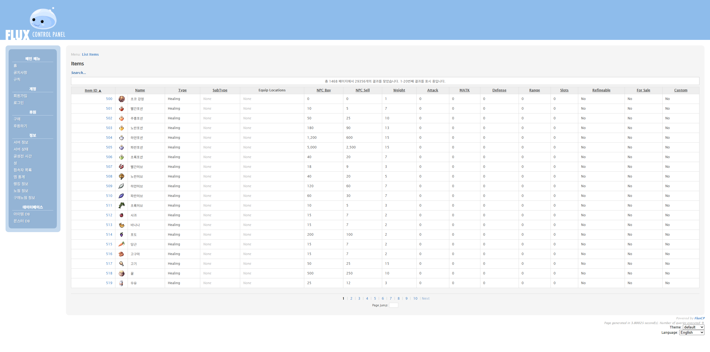

## 13년 된 레거시 패널

깃허브 기록을 확인해 보니 FluxCP의 첫 커밋은 2013년 11월 17일이었다. 무려 13년 전이다. 그 긴 시간 동안 FluxCP는 전 세계 수많은 rAthena 서버 운영자들에게 든든한 버팀목이자 사실상 표준 역할을 해왔다. 수많은 관리자와 유저들이 이 패널을 사용했을 것이다.

하지만 13년이라는 세월이 흐른 만큼, 웹 생태계의 기술 표준과 사용자의 눈높이도 크게 달라졌다.

FluxCP는 그 당시의 전형적이고 안정적인 PHP 웹 구조로 만들어져 지금까지도 제 역할을 충실히 해내고 있지만, 반응형 모바일 인터페이스나 실시간 인터랙션 같은 현대적인 웹 경험을 기대하기에는 시대적인 차이가 있었다. 또한 설정을 변경하려면 설정 파일(`config.php`)을 직접 열어 수정해야 하는 등, 오늘날의 직관적인 웹 대시보드 환경에 익숙한 사람들에게는 조금 낯설고 번거롭게 느껴지는 부분들도 있었다.

## 바닥부터 만들기

처음에는 기존 FluxCP의 테마를 손보거나 플러그인을 붙여볼까도 생각했다. 하지만 13년 동안 견고하게 자리 잡은 구조 위에서 작업하려니, 생각보다 큰 벽에 부딪혔다.

결국 내가 가장 잘 다룰 수 있는 도구로 바닥부터 새로 만들어보자는 결론을 내렸다.

이렇게 처음부터 다시 구현하기로 결심한 데에는 지극히 현실적인 이유들이 있었다.

1. **나는 PHP를 잘 모른다**
    - FluxCP는 훌륭하게 작동하는 도구였지만, 내 주력 언어가 아니다 보니 사소한 기능 하나를 수정하거나 확장하려 해도 많은 시간과 학습 비용이 들었다. 익숙하지 않은 환경에서 씨름하기보다는, 내가 강점을 가진 분야에 집중하는 편이 훨씬 낫다고 판단했다.
2. **나에게 가장 익숙한 도구는 Node.js 생태계다**
    - 평소 가장 손에 익어 있고 빠르고 유연하게 다룰 수 있는 도구가 바로 JavaScript와 TypeScript, 그리고 Node.js 풀스택 환경이었다.
3. **새로운 웹 기술들을 직접 사용해보고 싶었다**
    - Next.js 16의 App Router, Server Actions, 그리고 당시 한창 사용을 해보고 있던 Drizzle ORM 같은 최신 웹 기술들을 프로젝트에 깊이 있게 녹여내 보고 싶었다. 가상의 토이 프로젝트가 아니라 실제 게임 데이터베이스와 연동되는 완성도 높은 풀스택 웹앱을 만들어 보는 것은 매력적인 도전이었다.

그렇게 rAthena를 위한 새로운 웹 제어판, **RZCP**를 만들기 시작했다.

## 두 가지 개발 원칙

프로젝트를 시작하면서 스스로에게 두 가지 확고한 원칙을 세웠다.

### 1. Clean-Room Principle

기존 FluxCP의 소스 코드는 어떤 기능들이 필요한지 요구사항과 워크플로우를 파악하는 용도로만 참고하고, **단 한 줄의 PHP 코드도 직접 가져오거나 변환하지 않는다**는 원칙이다.

FluxCP가 구축해 둔 훌륭한 기능 명세를 존중하되, 구현 방식은 과거의 구조에 얽매이지 않고 현대적인 React와 Next.js 생태계의 패러다임에 맞추어 처음부터 새롭게 설계하고 싶었다. 완전히 백지상태에서 시작해야만 컴포넌트 기반 UI와 최신 상태 관리, 서버 사이드 렌더링의 이점을 온전히 살릴 수 있기 때문이다.

### 2. Zero-Modification Principle

RZCP가 실제 환경에서 의미를 가지려면, 기존에 rAthena 서버를 운영하던 사람들이 아무런 부담 없이 도입할 수 있어야 했다.

따라서 **rAthena의 핵심 MySQL 데이터베이스 스키마(****`login`****,** **`char`****,** **`map`** **등)를 임의로 수정하지 않는다**는 기준을 세웠다.

- 컬럼 하나, 인덱스 하나도 임의로 추가하거나 데이터 타입을 바꾸지 않는다.
- 13년 넘게 이어져 온 rAthena의 데이터 구조와 비밀번호 암호화 방식을 100% 온전히 존중하고 호환한다.
- 웹 패널 전용으로 필요한 데이터(공지사항, CMS, 웹 설정 등)는 반드시 `rzcp_` 접두사를 붙여 완전히 격리된 독립 테이블로만 생성한다.

기존 데이터베이스를 마음대로 바꿀 수 없다는 것은 개발 과정에서 많은 고민을 안겨주는 제약이었지만, RZCP가 지켜야 할 가장 중요한 정체성이었다.

## 첫 삽을 뜨며

개발 환경은 Next.js 16 (App Router)과 **TypeScript**, **Tailwind CSS**, 그리고 **Shadcn UI**를 기반으로 잡았다.

오랜 시간 동안 rAthena 커뮤니티를 지탱해 준 FluxCP의 발자취를 따라가면서, 내가 가장 익숙하고 좋아하는 현대적인 기술들로 그 경험을 새롭게 빚어내는 작업이었다.

마주하게 될 레거시 데이터베이스와의 연동이나 아키텍쳐적 고민들을 다 예상하진 못했지만, 13년을 발전해온 프로젝트를 다른 방식으로 구현해본다는 생각에 기대가 됐다.

