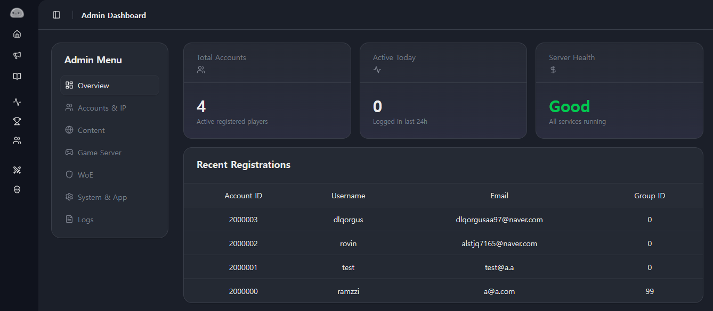

## Drizzle ORM


프로젝트를 시작하며 가장 먼저 부딪힌 문제는 데이터베이스였다.


rAthena의 MySQL 데이터베이스는 오랜 세월 동안 발전해 온 만큼 스키마가 매우 독특하다. 외래 키 제약 조건이 거의 걸려있지 않고, 수많은 플래그 값들이 `tinyint`나 `enum`으로 관리되며, 복합 기본 키가 빈번하게 사용된다.


처음에는 Next.js 생태계에서 가장 널리 쓰이는 Prisma를 사용할까 고민했다. 하지만 Prisma는 자체 스키마 파일(`.prisma`)을 정의해야 하고, 기존 데이터베이스와의 싱크를 맞추는 과정에서 Schema Drift가 발생하기 쉬웠다. 또한 rAthena의 독특한 테이블 구조를 Prisma 모델로 온전히 표현하기에는 제약이 많았다.


무엇보다 "기존 데이터베이스 스키마를 임의로 수정하지 않는다"는 원칙을 지키기 위해서는 SQL에 최대한 가깝고 투명하게 쿼리를 다룰 수 있는 도구가 필요했다.


그래서 선택한 것이 **Drizzle ORM**이었다.


Drizzle은 SQL 친화적인 쿼리 빌더이면서도 TypeScript와 완벽하게 통합된다. `drizzle-kit introspect` 명령어를 사용해 rAthena의 기존 MySQL 테이블을 있는 그대로 스캔하여 TypeScript 스키마로 추출할 수 있었고, rAthena의 독특한 컬럼 타입들도 무리 없이 타입 안전성을 확보하며 코드로 매핑할 수 있었다.


## NextAuth


데이터베이스 연결을 마친 뒤 마주한 다음 과제는 인증이었다.


현대 웹 애플리케이션에서는 비밀번호를 저장할 때 bcrypt나 Argon2 같은 안전한 단방향 해시 알고리즘을 사용하는 것이 상식이다. 하지만 RZCP는 게임 서버와 동일한 `login` 테이블을 공유해야 했다. 즉, 게임 클라이언트가 접속할 때 사용하는 비밀번호 검증 로직과 웹 패널의 검증 로직이 정확히 일치해야 했다.


rAthena는 전통적으로 MD5 해시 방식을 사용해 왔다. (서버 설정에 따라 SHA256이나 솔트가 적용되기도 한다.)


웹 패널에서만 안전한 최신 암호화 알고리즘을 도입하면 클라이언트에서 로그인을 할 수 없게 되므로, 선택의 여지 없이 rAthena의 해시 방식을 그대로 따라야 했다.


```typescript
// rAthena 암호화 방식에 맞춘 패스워드 검증 로직
const isPasswordValid = verifyRathenaPassword(inputPassword, user.user_pass, hashType);
```


NextAuth.js v5를 사용해 커스텀 Credentials Provider를 구축하고, 유저가 입력한 비밀번호를 rAthena 서버 설정에 맞는 해시 알고리즘으로 변환하여 대조하도록 인증 파이프라인을 작성했다.


비록 웹 표준 관점에서는 오래된 암호화 방식이지만, 환경 변수로 해시 타입을 유연하게 전환할 수 있도록 설계하여 rAthena와의 100% 호환성을 달성할 수 있었다.


## FSD 아키텍처


인증이 끝나고 계정 관리, 캐릭터 랭킹, 인벤토리 뷰어, 관리자 도구 등 기능이 하나둘씩 추가되면서 코드베이스의 덩치가 급격하게 불어났다.


처음에는 일반적인 Next.js 프로젝트처럼 `components/`, `lib/`, `actions/` 형태로 디렉토리를 나누어 작업했다. 하지만 프로젝트 규모가 커지자 랭킹 관련 로직과 관리자 로직, 공용 UI 컴포넌트들이 뒤엉키기 시작했다. 특정 기능을 수정하려고 할 때 여러 폴더를 오가며 파일을 찾아야 하는 불편함이 점점 커졌다.


이 혼란을 정리하기 위해 **Feature-Sliced Design (FSD)** 패턴을 도입하기로 결정했다.


!image.png


모든 도메인 로직을 `src/features/` 하위에 기능별로 완벽하게 격리시켰다.

- `src/features/auth` : 인증 및 회원가입 관련 로직
- `src/features/account` : 내 캐릭터 및 계정 설정
- `src/features/ranking` : 실시간 유저/길드 랭킹
- `src/features/admin` : 관리자 제어판 및 시스템 설정

각 기능 폴더 내부에서만 쓰이는 컴포넌트, 훅, 서버 액션을 해당 폴더 안에 응집시키자, 프로젝트의 구조가 한눈에 들어오기 시작했다. 어떤 기능을 고치더라도 다른 도메인에 사이드 이펙트를 줄 걱정이 사라졌다.


## 컴포넌트 리팩토링


FSD로 구조를 정리한 뒤에도 관리자 패널은 여전히 골칫거리였다.


관리자 패널은 유저 검색, 계정 제재, 캐시 지급, 시스템 로그 조회 등 수행해야 할 역할이 워낙 많았다. 초기에는 관리자 페이지의 각 탭마다 거대한 단일 컴포넌트를 두고, 최상단 `page.tsx`에서 모든 데이터를 페칭한 뒤 수많은 Props를 자식 컴포넌트로 내려주는 3계층 Monolithic 구조로 작성되어 있었다.


이로 인해 Prop Drilling이 극심해졌고, 사소한 UI 하나를 수정하려 해도 수백 줄짜리 거대 파일을 뒤져야 했다.


이를 해결하기 위해 관리자 화면의 구성 요소들을 **14개의 독립적인 카드(****`*Card.tsx`****)** 컴포넌트로 전면 분리했다.





각 카드는 자신이 필요한 데이터와 Server Actions만을 독립적으로 책임지도록 만들었다. 복잡했던 Props 전달이 완전히 사라졌고, 컴포넌트의 재사용성과 가독성이 크게 향상되었다.


레거시 데이터베이스라는 까다로운 환경 위에서 출발했지만, 현대적인 아키텍처와 컴포넌트 설계를 적극적으로 도입하면서 점차 단단하고 유지보수하기 편한 구조를 갖추어 나갈 수 있었다.

