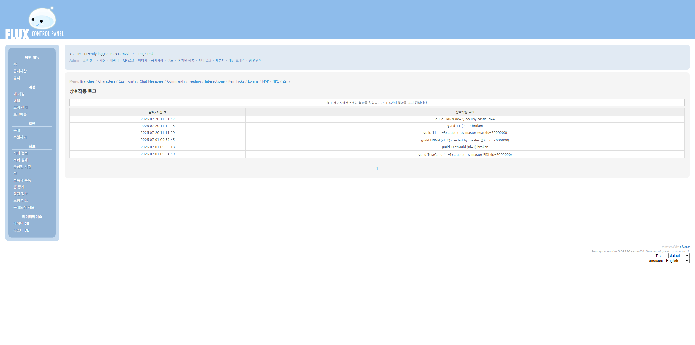
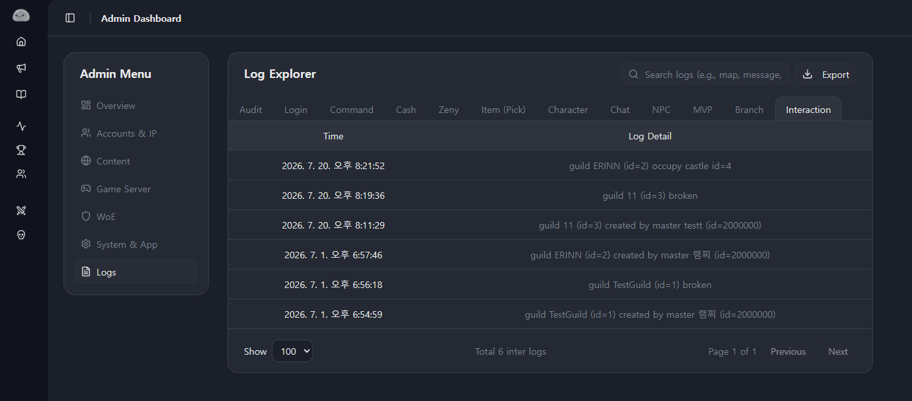
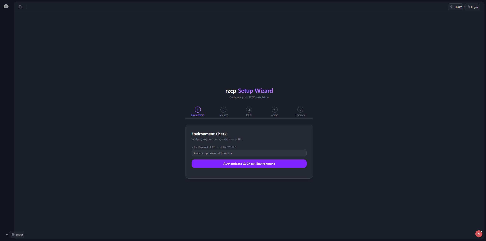
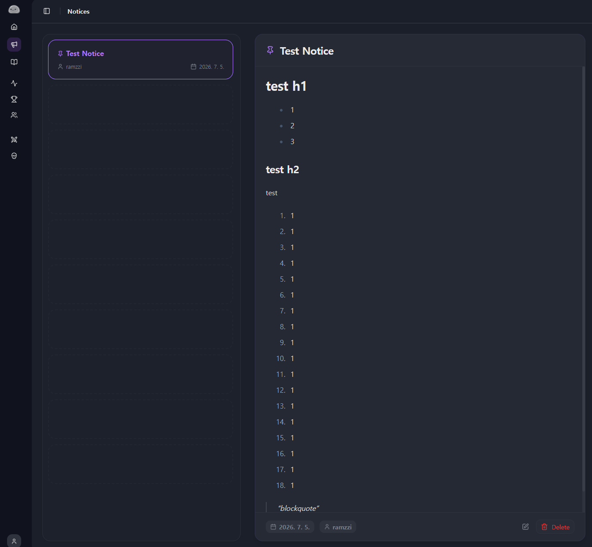
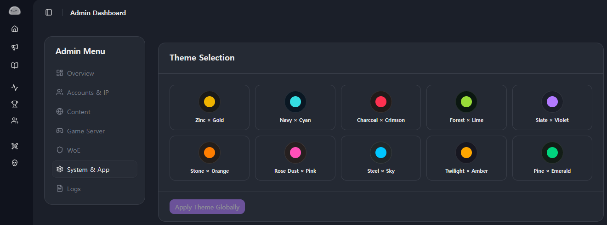
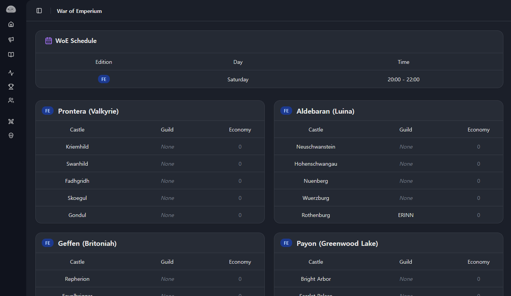

## Log Explorer


rAthena는 서버 내에서 발생하는 거의 모든 동작을 데이터베이스에 로그로 남긴다.


로그인 기록인 `loginlog`부터 명령어 사용 내역인 `atcommandlog`, 재화의 흐름을 추적하는 `zenylog` 등 시스템 로그 테이블만 10개가 훌쩍 넘는다.





기존 FluxCP에서도 이러한 로그들을 조회할 수 있었지만, 쿼리 파라미터(`?module=logdata&action=...`) 기반의 전통적인 방식이었기 때문에 로그 종류를 바꿀 때마다 매번 전체 페이지가 새로고침되는 깜빡임을 겪어야 했다. 또한 게임 서버 로그(`logdata`)와 웹 패널 관리 로그(`cplog`)가 서로 다른 메뉴로 나뉘어 있어 전체적인 흐름을 한눈에 대조하기 번거로웠다.


이 경험을 개선하기 위해 12종의 시스템 로그를 단일 뷰로 묶은 **Log Explorer**를 만들었다.




1. **단일 탭 대시보드 통합**
    - 서로 다른 메뉴로 쪼개져 있던 게임 로그들과 RZCP의 자체 웹 감사 로그(Audit Log)까지 12개의 로그를 폴더 탭 형태로 한 화면에 모았다.
2. **새로고침 없는 즉각적인 탐색**
    - TanStack React Query와 디바운스(Debounce) 검색을 적용해, 탭을 전환하거나 검색어를 입력해도 페이지 리로드 없이 부드럽게 데이터를 불러오도록 구성했다.
3. **대용량 로그 처리**
    - 수십만 건 이상 쌓이는 로그의 특성을 고려해 서버 사이드 페이지네이션을 적용하여 대용량 환경에서도 메모리 부담 없이 빠르게 렌더링되도록 처리했다.

## Setup Wizard


아무리 좋은 웹 패널을 만들어도 설치 과정이 복잡하면 사용하기 꺼려진다.


기존 패널들은 설정 파일을 텍스트 에디터로 직접 열어 데이터베이스 계정과 비밀번호를 일일이 입력하고, 권한 테이블을 수동으로 임포트해야 하는 번거로움이 있었다.


RZCP에서는 첫 설치 과정을 최대한 간소화하기 위해 5단계 인터랙티브 **Setup Wizard**를 구축했다.




1. 시스템 환경 점검
2. rAthena 데이터베이스 연결 및 테스트
3. 메인 서버 및 문자셋 설정
4. 관리자 계정 지정 및 권한 부여
5. 초기 설정 완료 및 락(Lock) 처리

웹 브라우저에서 버튼 클릭 몇 번으로 데이터베이스 연결 상태를 실시간으로 테스트하고 설정을 마칠 수 있게 했다. 설치가 완료되면 위저드 접근을 자동으로 차단하여 보안 위험도 방지했다.


## In-Context Editing


공지사항이나 서버 규칙 같은 텍스트 컨텐츠를 관리할 때의 경험도 개선하고 싶었다.


보통은 관리자 패널로 이동해 긴 목록에서 해당 글을 찾고, 수정 페이지로 들어간 뒤 내용을 바꾸고, 다시 공개 페이지로 돌아와서 잘 적용되었는지 확인하는 번거로운 과정을 거친다.


이 동선을 줄이기 위해 **In-Context Editing** 방식을 도입했다.





관리자 권한을 가진 계정으로 로그인한 상태라면, 공지사항 목록이나 서버 규칙 페이지를 둘러보다가 화면 구석의 편집 버튼을 눌러 그 자리에서 즉시 수정 모달을 띄울 수 있게 만들었다.


마크다운 에디터 라이브러리는 번들 크기가 제법 큰 편인데, 일반 유저에게까지 이 무거운 에디터 스크립트를 다운로드하게 할 수는 없었다. 따라서 Next.js의 `next/dynamic`을 활용해 관리자가 실제로 편집 모달을 호출하는 순간에만 에디터 번들을 비동기로 불러오도록 최적화했다.


## 캐싱 전략


실시간 서버 접속자 수와 캐릭터/길드 랭킹은 유저들이 빈번하게 조회하고 새로고침하는 기능이다.


하지만 접속자가 많은 서버일수록 랭킹을 매번 데이터베이스에서 전체 집계하여 긁어오는 것은 DB에 큰 부담을 준다. 그렇다고 데이터가 너무 오랫동안 갱신되지 않으면 랭킹 시스템으로서의 의미가 퇴색된다.


이 균형을 맞추기 위해 Next.js의 `unstable_cache`를 적용했다.


```typescript
export const getCachedRankings = unstable_cache(
  async (type: RankingType) => fetchRankingsFromDb(type),
  ['rankings-cache-key'],
  { revalidate: 60 } // 60초 주기 갱신
);
```


기본적인 랭킹 데이터는 60초 단위로 서버 캐시를 재검증하도록 설정해 불필요한 DB 쿼리 폭주를 원천 차단했다.


클라이언트에서는 탭을 전환하거나 상세 페이지를 오갈 때 TanStack React Query를 활용하여, 한 번 불러온 캐시 데이터를 메모리에 보관해 화면 깜빡임 없이 즉각적인 UI 전환이 이루어지도록 구성했다.


## next-intl


보통은 뭘 만들던 다국어 지원은 필수적으로 하는 편이다. 한국어와 영어를 모두 매끄럽게 지원하기 위해 Next.js 생태계에서 널리 쓰이는 `next-intl`을 도입했다.


이 사전들을 분리해 번역을 적용해 나가다 보니, 컴포넌트 어딘가에서 키 이름을 잘못 적거나 누락하여 런타임 에러(`MISSING_MESSAGE`)가 발생하는 문제가 빈번하게 터져 나왔다.


이를 해결하기 위해 `global.d.ts`를 선언하여 TypeScript 레벨에서 번역 키에 대한 자동완성과 타입 세이프티를 확보했다. 더 나아가 프로젝트 내 모든 TSX 파일과 JSON 사전 파일을 전수 대조하는 검증 스크립트를 만들어, 누락되었던 154개의 번역 키를 일괄 색출하고 정리했다.


```typescript
// global.d.ts - next-intl 타입 안전성 확보
import en from './locales/en/ui.json';

type Messages = typeof en;

declare global {
  interface IntlMessages extends Messages {}
}
```


이 과정을 거치고 나서야 페이지 어디를 둘러보아도 번역 누락으로 인한 렌더링 깨짐이 없는 안정적인 다국어 환경을 완성할 수 있었다.


## 테마와 브랜딩


초기 RZCP는 UI 컴포넌트 곳곳에 Tailwind CSS 색상 클래스가 하드코딩되어 있었다.


이 방식은 빠르게 페이지를 만들 때는 편하지만, 서버 운영자가 사이트의 메인 컬러나 분위기를 바꾸고 싶을 때 수많은 코드 파일을 일일이 찾아다니며 수정해야 한다는 치명적인 단점이 있었다.


이를 해결하기 위해 디자인 시스템을 **OKLCH 시맨틱 테마** 구조로 전면 개편했다.





모든 컴포넌트가 `bg-background`, `text-primary`, `border-border` 같은 시맨틱 변수만을 바라보도록 통일하고, 관리자 패널에서 테마 프리셋을 선택하면 사이트 전체의 색상 팔레트가 즉시 전환되도록 만들었다.


또한 서버마다 고유한 아이덴티티를 살릴 수 있도록 사이트 로고와 파비콘 업로드 기능도 추가했다. 브라우저가 이전 이미지를 계속 기억하고 있어 로고를 바꿔도 화면에 바로 반영되지 않는 문제를 방지하기 위해, 데이터베이스에 저장된 업데이트 타임스탬프를 쿼리 파라미터로 붙여주는 캐시 버스팅(Cache-Busting) 로직도 함께 적용했다.


## 공성전 대시보드


라그나로크의 핵심 엔드 콘텐츠를 꼽으라면 단연 성을 차지하기 위한 길드 간의 대규모 전투, **공성전(War of Emperium)**이다. FluxCP에서도 성 점령 현황과 공성 일정을 보여주는 모듈이 있는데, RZCP에서도 이를 단일 대시보드로 재구현했다.





각 성을 점령하고 있는 길드의 엠블럼과 길드명은 `guild_castle` 테이블에 저장되어 있고, 서버 스크립트가 제어하는 공성전 진행 시간과 상태 플래그는 `mapreg` 테이블에 흩어져 있었다.


Drizzle ORM을 활용해 두 테이블의 데이터를 병렬로 비동기 페칭한 뒤, 각 공성 지역(프론테라, 게펜, 알데바란, 페이욘, 아룬펠츠 등)별 성 점령 현황과 실시간 공성전 상태를 직관적인 카드 그리드 형태로 시각화했다.


굳이 게임에 접속하지 않아도 웹 대시보드에서 현재 각 성을 지배하고 있는 길드가 어디인지, 다음 공성전까지 남은 시간은 얼마인지 한눈에 확인할 수 있게 되었다.

