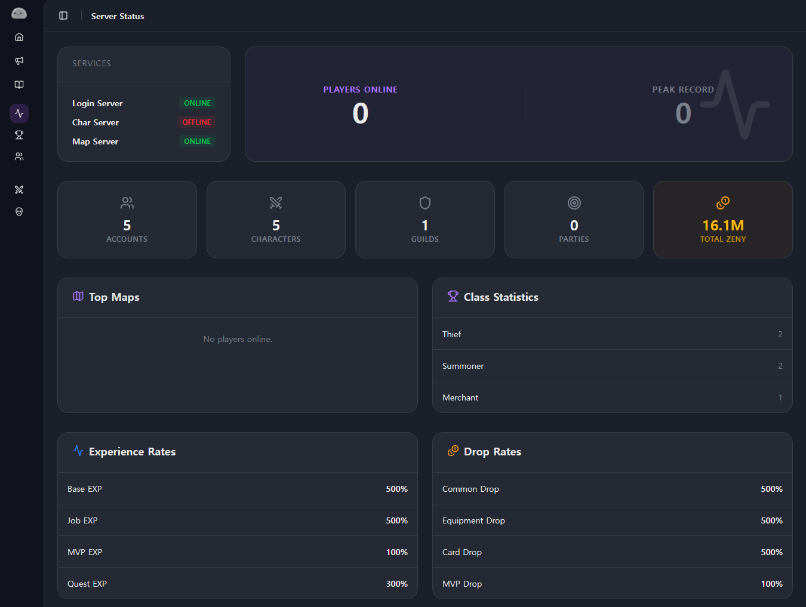
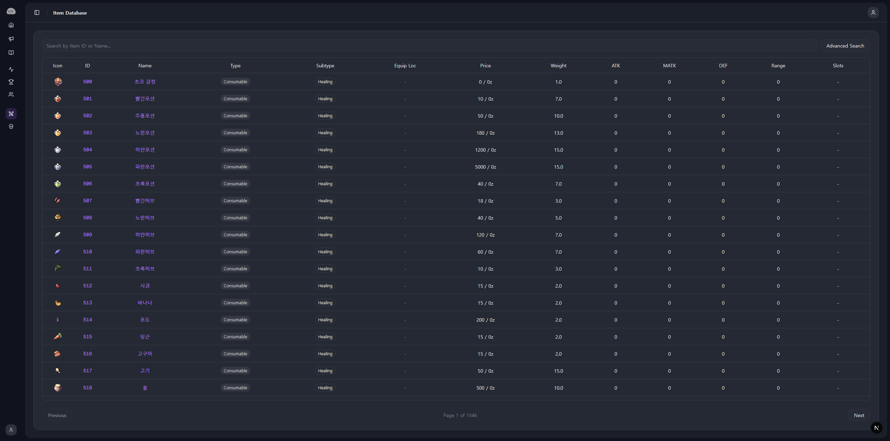

## RZCP 완성

보일러플레이트 세팅부터 시작해 계정 관리, 캐릭터 및 길드 랭킹, 11종의 시스템 로그 뷰어, 셋업 위저드, 그리고 공성전 대시보드까지 필요한 기능들을 차근차근 구현해 나갔다.

오랜 시간 동안 rAthena 생태계를 지켜온 FluxCP의 기능들을, 내가 익숙한 Next.js 16과 TypeScript, Drizzle ORM 환경으로 무사히 옮겨올 수 있었다. 레거시 데이터베이스 스키마를 단 하나도 건드리지 않으면서도, 현대적인 웹 환경에 걸맞은 반응형 UI와 빠른 사용자 경험을 갖춘 웹 패널이 완성되었다.

## 실제로 써보지는..

하지만 아쉽게도 이렇게 완성된 RZCP를 실전에서 직접 사용해보지는 못했다.

개발을 진행하는 동안에는 컴퓨터에 rAthena 서버를 직접 빌드하고 구동해가며 데이터가 정상적으로 오가는지, 로그와 랭킹이 제대로 찍히는지 수없이 테스트를 거쳤다. 기능적으로는 당장이라도 배포해서 실제 서버에 물려 쓸 수 있는 상태가 되었다.

하지만 테스트 환경을 벗어나 실제 유저들이 접속하는 라이브 서버를 운영하지 않다 보니, 자연스럽게 RZCP 역시 실전에서 활용할 일이 없어졌다.

목적지를 잃어버린 프로젝트는 더 이상 기능을 덧붙일 이유가 없었고, 그렇게 RZCP의 개발도 마침표를 찍게 되었다.

## 프로젝트를 돌아보며

비록 실제로 운영에 투입해보지는 못하고 멈추게 되었지만, 결코 무의미한 시간은 아니었다.

PHP를 잘 몰라 시작했던 작업이었지만, 13년 된 레거시 데이터베이스 스키마를 전혀 수정하지 않는다는 엄격한 제약 속에서 오히려 많은 것을 고민하고 배울 수 있었다.

- 독특한 레거시 테이블 구조를 Drizzle ORM과 타입 안전하게 연결하는 방법
- 과거의 MD5 해시 암호화를 현대적인 NextAuth 파이프라인에 조화시키는 방법
- 프로젝트가 커짐에 따라 코드의 응집도를 유지하기 위해 도입했던 FSD 아키텍처와 아토믹 컴포넌트 설계
- `nstable_cache`와 React Query를 통한 서버 부하 방지 및 캐싱 전략

라이브 서비스로 이어지지는 못했지만, 내가 좋아하는 기술들을 마음껏 써보며 13년 동안 발전해 온 오픈소스의 발자취를 따라가며 나만의 방식으로 재해석해 본 여정, 그것만으로도 충분히 즐거운 경험이었다.

