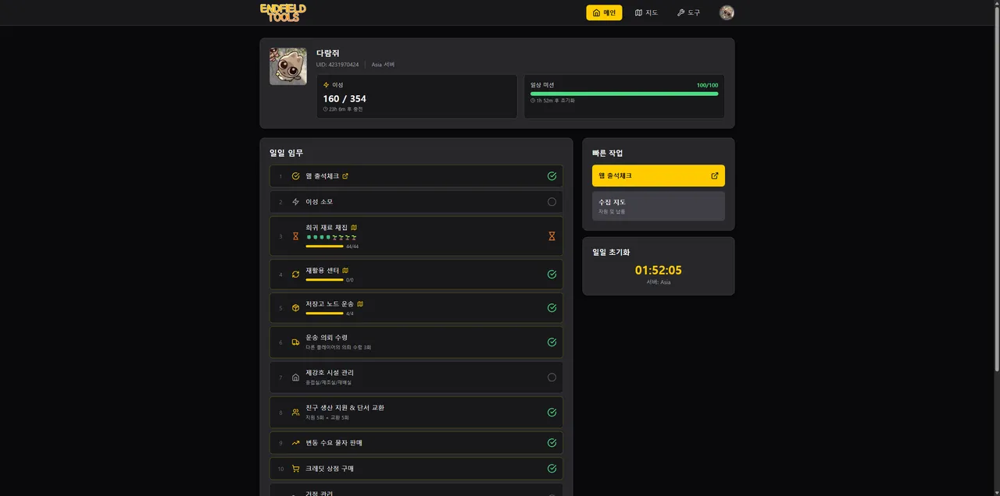
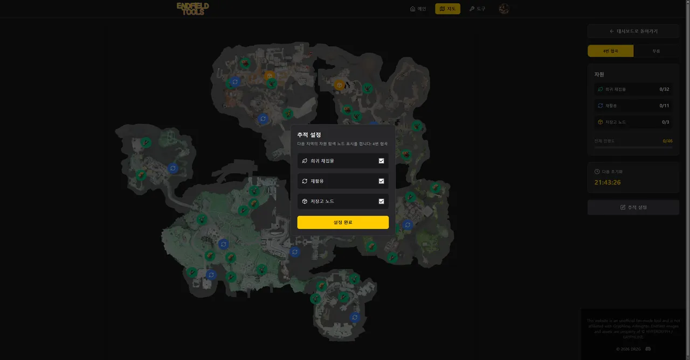
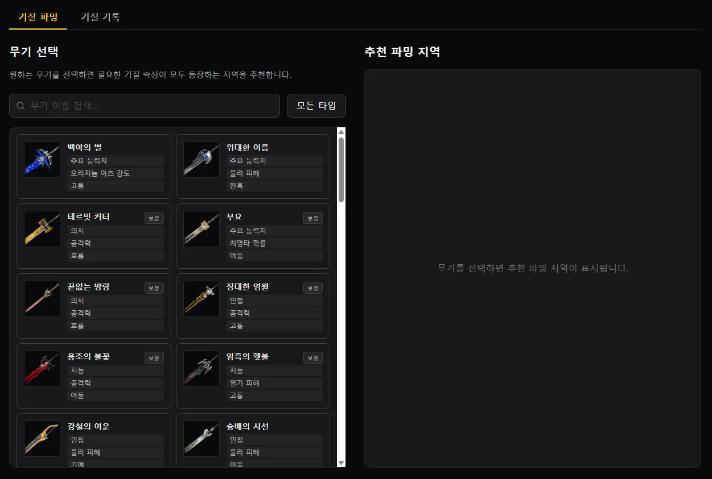
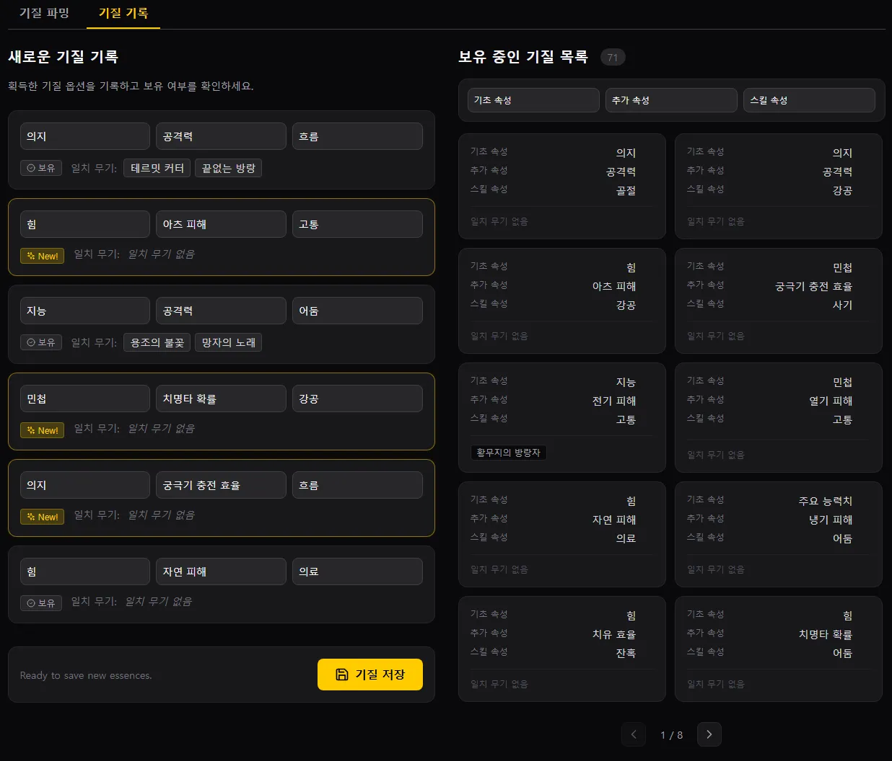

## 시작하게 된 계기


최근 기존에 공들여 운영하던 **TA-TA** 프로젝트를 간소화하여 가벼운 정적 사이트인 `TA-TA lite`로 리빌딩하는 작업을 진행하고 있다. 완전히 가벼운 버전으로 넘어가기 전, 지난 9개월 동안 이 프로젝트에 쏟아부었던 수많은 고민과 삽질의 기록들을 블로그 포스트로 차근차근 정리해두려 한다.


9개월 전, **명일방주: 엔드필드**가 오픈했던 시점, 며칠 플레이해 보니 머리가 지끈거리기 시작했다. 흔히 '숙제'라고 부르는 컨텐츠가 생각보다 꽤 많았던 것이다.


"어제 내가 그 재료를 캤던가?"
"이거 오늘 리셋 됐나 안 됐나?"


메인 퀘스트도 밀어야 하는데, 내가 뭘 했고 뭘 안 했는지를 확인하느라 인게임 메뉴를 뒤적거리며 기억을 더듬는 데만 한세월이 걸렸다. 이런 건 머리로 외우는 게 아니다. 글 쓰는 게 귀찮으면 블로그를 안 쓰듯, 숙제 확인하는 게 귀찮으면 게임 접속 자체가 꺼려지게 된다!


당시에는 체크리스트 사이트가 없던 상태였고, 내가 편하게 쓸 체크리스트 웹사이트를 하나 만들어야겠다는 생각으로 TA-TA 프로젝트(당시에는 Endfield Tools)의 첫 삽을 뜨게 됐다.


## 숙제 체크리스트





처음에는 그냥 체크박스 몇 개 두고 DB에 저장하면 끝나는 간단한 To-Do 리스트인 줄 알았다. 하지만 문제가 있었는데, 숙제마다 **초기화되는 타이밍과 규칙이 제각각**이었던 것이다.

1. **매일 초기화**: 매일 새벽 서버 리셋 기준 (한국 시간 기준 새벽 5시 / 서버 시간 04:00)
2. **주간 초기화**: 매주 월요일 새벽 서버 리셋 기준
3. **N일 주기 초기화**: 4일 등 특정 일수 간격으로 서버 리셋 시점에 초기화되는 컨텐츠
4. **완료 시점 기준 쿨다운**: 서버 리셋 시간과 전혀 상관없이, 유저가 인게임에서 해당 행동을 완료한 시점부터 N시간/N일 뒤에 다시 활성화되는 컨텐츠

이걸 하나의 리셋 관리 시스템에서 한눈에 깔끔하게 굴리려면 단순한 `boolean` 체크로는 택도 없었다. 각 숙제(Task)의 완료 시각(`completedAt`)과 리셋 전략(`resetStrategy`: `server` vs `cooldown`), 주기 단위(`customUnit`)를 모델링하고 현재 시각과 비교해 자동으로 상태를 되돌리는 스케줄링 로직이 필요했다.


```typescript
// 당시 작성했던 useProgressStore.ts 중 일부
resetFixedTasks: (period?: "daily" | "weekly" | "custom", specificTaskId?: string) => {
    set((state) => {
        const nextProgress = { ...state.taskProgress };
        const now = new Date();

        state.masterTasks.forEach((task) => {
            if (specificTaskId && task.taskId !== specificTaskId) return;
            if (period && task.resetPeriod !== period && !specificTaskId) return;

            const progress = state.taskProgress[task.taskId];
            if (!progress || progress.status !== "completed") return;

            // 1. [쿨다운 전략] 유저가 완료한 시점부터 N분/시간/일 경과 후 리셋
            if (task.resetStrategy === "cooldown") {
                if (progress.completedAt) {
                    let cooldownMs = 0;
                    const val = task.customValue || 0;
                    if (task.customUnit === "days") cooldownMs = val * 24 * 60 * 60 * 1000;
                    else if (task.customUnit === "hours") cooldownMs = val * 60 * 60 * 1000;
                    else if (task.customUnit === "minutes") cooldownMs = val * 60 * 1000;

                    const resetAt = new Date(progress.completedAt).getTime() + cooldownMs;
                    if (now.getTime() >= resetAt) {
                        nextProgress[task.taskId] = { id: task.taskId, status: "pending", completedAt: null };
                    }
                }
            // 2. [서버 기준 리셋] 서버 타임존 04:00 AM 기준 (Daily, Weekly, Custom Days)
            } else if (task.resetStrategy === "server") {
                // 서버 타임존 경계값과 비교하여 이전 주기 완료 건이면 pending으로 초기화
                const threshold = getResetThreshold(task.resetPeriod);
                if (new Date(progress.completedAt).getTime() < threshold) {
                    nextProgress[task.taskId] = { id: task.taskId, status: "pending", completedAt: null };
                }
            }
        });

        return { taskProgress: nextProgress };
    });
}
```


이렇게 분기 처리를 해두니, 페이지를 열거나 포커스가 돌아올 때 백그라운드에서 만료된 숙제들을 알아서 깔끔하게 '미완료' 상태로 되돌려놓을 수 있게 되었다.


## 인터랙티브 맵


체크리스트를 만들고 나니 곧바로 두 번째 거대한 장벽을 만났다. 바로 **'희귀 재료 채집'** 숙제였다.


엔드필드에서는 대부분의 일반 재료나 거점 생산품은 원격으로 수거할 수 있지만, 특정 상위 장비나 시설에 들어가는 **희귀 재료는 무조건 유저가 직접 캐릭터를 끌고 현장까지 이동해서 손으로 채집(상호작용)** 해야 했다.


문제는 게임 오픈 시점 기준으로 맵 전역에 흩어져 있는 희귀 재료 스팟이 무려 **45군데**나 되었다는 점이다.


체크리스트에 단순히 `[ ] 희귀 재료 채집` 하나만 달랑 적어두면, 45군데 중에 내가 어디를 돌았고 어디를 안 돌았는지를 도무지 알 수가 없었다. 그렇다고 텍스트로 45개 목록을 줄줄이 나열해두는 것도 안되는 게, 숙제 리스트는 최대한 간결하게 만들어야 덜 피곤하게 할 수 있다…


결국 맵 위에 직접 찍어서 보여주고, 캔 곳은 클릭해서 숨기거나 체크할 수 있어야겠다는 생각이 들었고, 그렇게 인터랙티브 맵(Interactive Map)을 추가하게 됐다.




- 인게임 맵 타일을 하나의 맵 이미지로 merge
    - 어차피 대략적인 위치만 확인하면 되는 거라 고해상도 맵 타일은 필요하지 않음
- 확대/축소 및 드래그 패닝 지원
- 45개 희귀 재료 포인트마다 마커를 찍고, 클릭 시 채집 완료(`completed`) 상태로 토글
- 완료된 마커는 반투명 처리되거나 필터로 숨길 수 있게 구현
- 숙제 체크리스트에서 채집 진행도 출력

맵을 띄워놓고 순회 경로를 짜면서 캔 스팟을 하나씩 클릭해 지워나가니, 숙제 도는 시간이 절반 이하로 줄어들었다. 하지만 이때부터 슬슬 일이 커진다는 생각이 들기 시작했다…


## 기질 관리


지도를 만들고 나니 이번엔 파밍 쪽에서 가려운 곳이 생겼다.


엔드필드의 무기 강화 시스템 중에는 **'기질(Essence)'**이라는 핵심 아이템이 있다. 무기에 기질을 장착해서 추가 스탯이나 특수 효과를 부여하는 식인데, 문제는 이 기질이 **드롭될 때 부여되는 옵션이 완전 랜덤**이라는 점이었다.








나 같은 경우 아직 3 옵션 모두 해당되는 무기가 없더라도 파밍 해둘 수 있다면 미리미리 파밍해서 모아두는 편이라, 어떤 옵션을 가지고 있는지 기록하고 싶었다. 인게임에서도 확인은 할 수 있지만, 인게임 인벤토리는 필터링이나 정렬이 다소 불편해서 웹에서 한눈에 보고 싶었다. 그래서 **기질 트래커(Essence Tracker)** 기능도 추가했다.

- **파밍 가이드**: 초기에는 무기를 직접 선택했을 때 해당 무기의 기질을 파밍할 수 있는 맵을 추천, 나중에는 직접 기질 옵션을 선택하는 방식도 업데이트
- **기질 기록(인벤토리)**: 내가 보유한 기질의 수치와 옵션 조합을 등록하고 필요할 때 필터링/검색

## 첫 릴리즈


여기까지 개발을 마쳤을 때의 구성:

1. **태스크 트래커 (숙제 체크리스트)**: 서버 시간(새벽 5시), N일 주기, 쿨다운 모두 대응
2. **인터랙티브 맵**: 45군데 희귀 재료 스팟 위치 표시 및 완료 토글
3. **기질 트래커**: 기질 드롭 위치 검색 및 보유 기질 인벤토리

이 세 가지 기능을 탑재한 상태로 **Endfield Tools**라는 이름을 붙여 커뮤니티에 처음으로 공개했다. 9개월 전 당시에는 이게 프로젝트의 전부였고, 이 정도면 됐다고 생각했다.


기왕 열심히 만든 거 혼자 쓰기 아까워서 커뮤니티에도 공개를 했는데, 꽤 많은 사람들이 사용을 하기 시작했다. 하지만 로그인 기능과 관련해서 문제가 생기는데…

