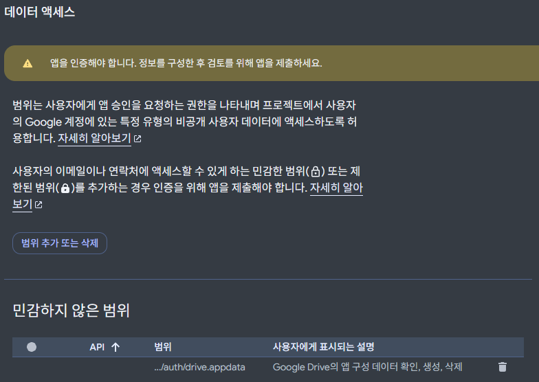

## **Discord** OAuth + MongoDB


이 프로젝트는 처음부터 **로그인을 한 상태로 사용하는 것을 기본 전제로 깔고 개발을 시작**했다.


왜냐하면 엔드필드는 보통 PC로 플레이하지만, 침대에 눕거나 외출했을 때 스마트폰으로 "오늘 숙제 뭐 남았더라?" 하고 확인하는 경우가 많았기 때문이다. PC와 모바일 사이에서 숙제 체크리스트와 맵 마커 상태가 실시간으로 동기화되는 것은 나에게 필수 조건이었다.


로그인 기능을 구현할 때 선택한 조합은 **Discord OAuth + MongoDB**였다.


내가 다뤄본 경험이 가장 많아 손에 익은 조합이기도 했고, 어차피 게임 팬사이트를 찾아올 게이머라면 디스코드 계정 하나쯤은 다들 가지고 있을 테니 접근성도 좋을 거라 생각했다. 유저가 디스코드로 로그인하면 Discord ID를 키로 MongoDB에 document를 하나 파서, 숙제 진행도(`taskProgress`)와 맵 마커(`foundMarkers`)를 기록했다.


구현도 빨랐고, PC와 모바일 간의 데이터 동기화도 깔끔하게 잘 동작했다. 이때까지만 해도 로그인과 동기화 아키텍처는 이걸로 완성된 줄 알았다.


## 구글 드라이브 AppData


문제는 그 다음에 구상했던 **"공식 홈페이지 데이터 연동"** 기능에서 터졌다.


엔드필드 공식 웹사이트(`skport.com`)의 출석체크 정보나 실시간 이성, 일일 임무 진행 상태 등을 웹사이트로 끌고 오려면, 유저의 게임 인증 토큰(`skportToken`, `accountUid`)을 어딘가에 보관하고 있어야 했다.


그런데 당시 가챠 기록을 조회하는 기능이 있는 사이트에서 스크립트에 악성 스크립트를 몰래 넣어두는 일이 있었고, 한동안 커뮤니티가 그 일로 시끄럽던 상태였다.


그러다보니 아무리 작은 팬사이트라지만 남의 게임 계정 인증 토큰을 개인 DB에 저장하는 건 보안상 위험하다는 생각이 들었다. 만에 하나라도 DB가 해킹당하거나 유출 사고라도 터지면 그 모든 법적·도의적 책임을 내가 감당할 수 없었다.


내가 유저의 비밀 토큰을 1바이트도 보관하지 않으면서, 유저가 여러 기기에서 편하게 동기화할 수 있는 방법은 없을지 며칠을 고민하다 찾아낸 해답이 바로 **Google Drive의 AppData (****`drive.appdata`** **scope)** 폴더였다.





구글 드라이브의 AppData 폴더는 유저의 일반 드라이브 화면에는 노출되지 않는 숨겨진 앱 전용 저장 공간이다.

- 오직 해당 앱의 구글 클라이언트 ID로 인증한 유저 본인만이 읽고 쓸 수 있다.
- 개발자의 중앙 서버 DB에는 민감한 토큰이 단 1바이트도 저장되지 않는다.
- 데이터는 유저 본인의 개인 구글 클라우드에만 안전하게 암호화되어 보관된다.

보안 책임을 유저의 안전한 구글 계정으로 위임할 수 있는 완벽한 해결책이었다. 하지만 변경하려면 처음부터 잘 쓰고 있던 디스코드 로그인을 통째로 들어내고, 구글 OAuth로 로그인 시스템을 전면 교체해야 했다.


결국 디스코드 로그인 관련 코드를 싹 걷어낸 뒤, 구글 로그인과 Google Drive API 연동 로직으로 아키텍처를 전면 개편했다. 비민감 데이터(숙제 체크, 맵 마커)는 MongoDB에 저장하고, 민감 데이터(skport 토큰 등)는 구글 드라이브 AppData에 격리 저장하는 **이원화 저장 구조**를 구축했다.


이 때를 기점으로 Endfield Tools라는 이름에서 TA-TA로 바뀌게 됐다. 이유는 해외 사이트 중 같은 이름을 가진 사이트가 있어서.. 해당 사이트를 사용하는 유저들에게 혼동을 줄 거 같았다.


그리고 주인공 일행에게 큰 도움을 주는 로봇인 TA-TA가 스토리에 등장하는데, 내 사이트도 유저들에게 도움을 주면 좋겠다는 생각에 이름을 변경했다.


하지만 로그인 방식 변경 과정에서 기존에 저장된 디스코드 로그인 사용자들의 데이터를 새로 사용할 구글 로그인 계정으로 옮겨줄 방법이 생각나지 않아 결국 사용자들이 새로 데이터를 입력해야 했다…


## 게스트 유저 지원


하지만 진짜 지옥은 로그인 전환 그 자체가 아니라, 바로 **게스트(비로그인) 유저 지원**에 있었다.


처음에는 내가 구글 로그인해서 쓰면 그만이었지만, 사이트를 커뮤니티에 공개하고 나니 비로그인 상태로 사용하려는 사람들이 생각보다 많았다. 하지만 기질 관리 기능은 로그인 상태로만 사용을 할 수 있었고, 이를 해결하기 위해 **로그인 없이도 브라우저의** **`LocalStorage`**(Zustand persist)를 기반으로 모든 기능을 쓸 수 있게 변경하기로 했다.


그런데 **애초에 '로그인 상태'를 기본 전제로 바닥부터 설계되었던 시스템**을 뒤늦게 게스트 유저까지 지원하려니, 온갖 기상천외한 레이스 컨디션과 버그들이 쏟아져 나오기 시작했다.


### 1. 새로고침 후 게스트 데이터 증발


어느 날 커뮤니티에서 "비로그인으로 지도 다 체크해뒀는데 새로고침하니까 싹 날아갔다"는 댓글이 달렸다. 확인해보니 등골이 오싹했다.


NextAuth에서 페이지를 새로고침하면 세션 상태가 잠시 `loading`을 거쳐 비로그인 상태인 `unauthenticated`로 떨어진다. 그런데 초기 코드의 `SyncManager`가 이 `unauthenticated` 상태를 보고는 게스트 유저의 로컬스토리지를 자비 없이 싹 비워버리고 있었던 것이다.


```typescript
// SyncManager.tsx 수정 전후
useEffect(() => {
  if (status === "unauthenticated") {
    // [수정 전] 비로그인 유저가 새로고침할 때마다 로컬 데이터를 다 날려버림
    // clearAllLocalData();

    // [수정 후] 이전에 '진짜로 로그인 상태였던' 유저가 로그아웃할 때만 로컬 비우기
    if (useUserStore.getState().isAuthenticated) {
      progressStore.clearProgressState();
      userStore.clearUserState();
      useMapStore.getState().clearMapState();
    }

    setAuthenticated(false);
    setHydrated(true);
    setIsDataLoaded(true);
    setIsCloudLoaded(true);
  }
}, [status]);
```


`isAuthenticated`라는 가드 플래그를 두어, **이전에 인증되어 있던 유저가 로그아웃/만료된 경우**에만 스토리지를 비우고, 순수 게스트 유저는 새로고침을 하든 창을 닫든 로컬 데이터가 절대 날아가지 않도록 했다.


### 2. 덮어쓰기 레이스 컨디션


또 다른 문제는 로그인 전환 시점이었다.


게스트 상태로 숙제를 체크하던 유저가 구글 로그인을 하게 되면, 브라우저의 로컬 상태와 서버(MongoDB + 구글 드라이브)의 상태가 충돌하게 된다.


특히 로그인 직후 MongoDB에서 데이터를 불러오는 중인데, 클라이언트 컴포넌트들이 상태가 바뀌었다고 비어있는 초기값을 서버로 자동 저장 해버려서 기존 DB 데이터를 지워버리는 끔찍한 레이스 컨디션이 발생했다.


```typescript
// SyncManager.tsx 중 일부
// MongoDB(isDataLoaded)와 구글 드라이브(isCloudLoaded)가 모두 로드되기 전까지는
// 그 어떤 자동 저장도 엄격하게 차단한다.
if (status === "authenticated" && isDataLoaded && isCloudLoaded && session?.user) {
  // 안전하게 데이터 병합이 완료된 이후에만 저장 실행
  if (mongoSyncTimeout.current) clearTimeout(mongoSyncTimeout.current);
  mongoSyncTimeout.current = setTimeout(async () => {
    // 저장 로직 수행
  }, 1000);
}
```


이를 해결하기 위해 MongoDB에서 가져오는 데이터와 구글 드라이브에서 가져오는 시크릿 파일이 **둘 다 완벽하게 로컬 스토어에 안착(Hydrate)했다는 서명이 떨어지기 전까지는 모든 자동 저장을 락(Lock)**으로 걸어버렸다.


### 3. 무한 루프


게스트 처리와 동기화를 조율하던 어느 날 밤, 콘솔 창이 붉은색으로 도배되기 시작했다.


```plain text
Error: Maximum update depth exceeded.
This can happen when a component repeatedly calls setState inside useEffect...
(React Error #185)
```


`SyncManager`가 전역 스토어 상태를 구독하고 있다 보니:

1. 시간/리셋 주기를 확인하고 스토어를 업데이트한다.
2. 스토어가 업데이트되니 `seEffect`가 다시 실행된다.
3. 다시 서버 동기화나 리셋 함수를 부른다.
4. 다시 상태가 바뀌면서 무한 렌더링 핑퐁 게임이 시작된다.

이 무한 루프를 잡겠다고 dependency array를 쪼개고, `useRef`로 이전 값들을 캐싱해 비교하고, 시간 타임존 오프셋 계산식을 순수 함수로 빼내는 등 며칠 밤낮을 머리를 쥐어뜯었다.


## 아무튼 해결


수많은 삽질 끝에 마침내 깔끔하..지는 않지만 어느 정도 안전한 동기화 아키텍처가 자리를 잡게 되었다.

- **게스트 유저**: 로그인 없이도 `LocalStorage`에서 빠르고 안전하게 모든 기능 사용 가능 (새로고침해도 절대 날아가지 않음)
- **로그인 유저**: 비민감 숙제/맵 데이터는 `MongoDB`로 실시간 멀티 디바이스 동기화, 민감한 게임 인증 정보는 본인의 `Google Drive AppData`에 분리 저장

처음부터 로그인 기반으로 짰던 시스템에 뒤늦게 게스트 모드를 붙이는 과정은 정말 험난했지만, 결과적으로는 유저 편의성과 보안을 둘 다 잡은 가장 뿌듯한 작업 중 하나였다.


하지만 결국에는 실시간 데이터 처리를 위해 토큰 데이터가 TA-TA의 서버에서 처리된다는 점이 계속 마음에 걸려서 또 다음 단계로 넘어가는데..

