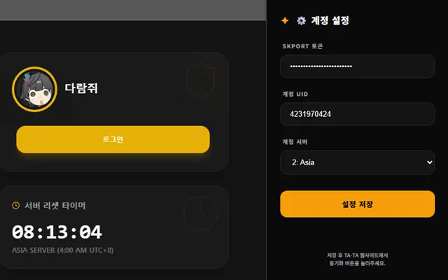

## 실시간 데이터 처리


구글 드라이브 AppData를 도입하면서 유저의 공식 게임 토큰(`skportToken`)을 내 MongoDB에 저장하지 않는 구조를 만들었다. 이제 DB가 털려도 토큰이 유출될 일은 없으니 안심할 수 있을 줄 알았다.


하지만 코드를 짜다 보니 또 다른 찝찝한 문제가 고개를 들었다. 바로 **CORS(Cross-Origin Resource Sharing)와 프록시 서버의 존재**였다.


웹 브라우저의 보안 정책상, `TA-TA` 웹사이트(예: `localhost`나 우리 도메인)의 자바스크립트가 공식 엔드필드 서버(`skport.com`, `zonai.skport.com`)로 직접 API 요청을 날리는 건 동일 출처 정책(SOP) 때문에 원천 차단된다.


결국 인게임의 실시간 데이터(이성 수치, 일일 임무 진행도, 출석체크 현황 등)를 받아오려면 **TA-TA의 웹 서버가 중계(Proxy) 역할**을 해줘야 했다.


```plain text
[유저 브라우저] --(토큰 전송)--> [TA-TA 백엔드 서버] --(공식 API 호출)--> [skport 공식 서버]
```


비록 DB에 토큰을 영구 저장하진 않는다 해도, 유저가 동기화 버튼을 누를 때마다 **유저의 민감한 토큰이 내 백엔드 서버의 메모리와 네트워크 트래픽을 거쳐 지나간다는 사실**은 변하지 않았다.


당시 커뮤니티는 다른 서드파티 사이트의 악성 스크립트 이슈로 보안에 대해 극도로 민감해져 있던 시기였다. 토큰 자체로 유저의 엔드필드 계정 자체에 뭔가 영향을 줄 수는 없지만, 그래도 토큰도 개인정보라 내 서버를 거쳐간다는 게 찝찝했다.


서버를 아예 안 거치고 유저 브라우저 안에서 공식 데이터를 직접 긁어올 수는 없을까?라는 고민 끝에 나온 아이디어가 바로 **크롬 익스텐션(Chrome Extension)을 전용 보안 프록시로 쓰는 것**이었다.


## 보안 프록시: TA-TA Sync


크롬 익스텐션은 일반 웹페이지와 달리 `manifest.json`의 `host_permissions`를 통해 외부 도메인과의 통신 권한을 가질 수 있어 브라우저의 CORS 제약에서 자유롭다. 게다가 유저가 같은 브라우저에서 공식 사이트에 로그인해 있다면 쿠키를 직접 읽어올 수도 있다.


이 점에 착안해 **TA-TA Sync**라는 이름의 크롬 확장 프로그램을 만들기 시작했다.


구조는 단순하지만 명확했다:




1. **토큰 자동 감지 및 로컬 격리**: 유저가 `skport.com`에 로그인한 뒤 익스텐션 팝업을 열면, 익스텐션이 브라우저 쿠키에서 `ACCOUNT_TOKEN`을 자동으로 찾아낸다. 이 토큰은 **익스텐션의 내부 격리 저장소(****`chrome.storage.local`****)에만 보관**된다.
2. **데이터 중계 요청**: TA-TA 웹사이트에서 [동기화] 버튼을 누르면, 웹사이트는 토큰을 달라고 하지 않는다. 대신 익스텐션에게 공식 데이터 좀 대신 조회해달라는 메시지만 던진다.
3. **자체 API 호출 및 전달**: 익스텐션의 백그라운드 스크립트가 직접 공식 서버와 통신하여 데이터를 받아온 뒤, **오직 가공된 게임 결과 데이터(이성 수치 등)만 웹사이트로 전달**한다.

이렇게 하니 **민감한 토큰은 유저 브라우저의 익스텐션 영역 밖으로 단 1mm도 나가지 않고**, 내 백엔드 서버는 토큰 근처에도 가지 못하는 완벽한 **Zero-Trust 아키텍처**가 완성됐다.


## OAuth2와 Sign 서명


아이디어는 완벽했지만 실제 구현은 또 다른 삽질의 연속이었다. 공식 사이트의 API 호출 메커니즘이 생각보다 훨씬 까다로웠기 때문이다. 단순히 토큰 하나 헤더에 실어 보낸다고 데이터를 뱉어주는 게 아니었다.


공식 데이터를 가져오기 위해서는 3단계의 인증 및 암호화 과정을 거쳐야 했다:

1. **OAuth2 Code 발급**: 가지고 있는 `SKPORT_TOKEN`으로 skport 인증 서버에 요청해 일회성 `code`를 발급받는다.
2. **Cred 및 Token 생성**: 발급받은 `code`를 들고 Zonai API 서버에 요청해 실제 통신에 쓰일 `cred`와 임시 `token`을 발급받는다.
3. **HMAC-SHA256 & MD5 기반 Sign 헤더 생성**: 매 API 요청마다 URL 패스, 바디, 타임스탬프, 그리고 발급받은 토큰을 조합해 암호화 서명(`sign`)을 만들어 헤더에 동봉해야 했다.

```javascript
// background.js 중 서명 생성 로직
function computeSign({ token, path, body = "", timestamp }) {
    const headers = JSON.stringify({
        platform: "3",
        timestamp: timestamp,
        dId: "",
        vName: "1.0.0",
    });
    // path + body + timestamp + headers 조합 후 HMAC-SHA256 해싱 -> MD5 변환
    const signString = `${path}${body}${timestamp}${headers}`;
    const hmac = CryptoJS.HmacSHA256(signString, token).toString(CryptoJS.enc.Hex);
    return CryptoJS.MD5(hmac).toString(CryptoJS.enc.Hex);
}
```


## 웹앱과 익스텐션 사이의 브릿지


마지막 관문은 **웹앱(React)과 크롬 익스텐션이 어떻게 대화를 나눌 것인가**였다.


보안상 일반 웹페이지의 자바스크립트는 익스텐션의 `background.js`와 직접 통신할 수 없다. 둘 사이를 연결해 줄 다리가 필요했고, 이를 위해 `content.js`를 웹페이지에 주입하여 메시지를 릴레이하는 브릿지 구조를 만들었다.


```javascript
// content.js
// 1. 웹앱에게 익스텐션이 준비되었음을 알림
window.postMessage({ type: 'TATA_EXT_READY' }, '*');

// 2. 웹앱에서 날아온 데이터 요청을 받아 background로 중계
window.addEventListener('message', (event) => {
    if (event.source !== window || !event.data) return;

    if (event.data.type === 'TATA_WEB_REQUEST') {
        chrome.runtime.sendMessage(event.data.payload, (response) => {
            // background에서 받은 응답을 다시 웹앱으로 반환
            window.postMessage({
                type: 'TATA_EXT_RESPONSE',
                messageId: event.data.messageId,
                response: response
            }, '*');
        });
    }
});
```


웹앱에서는 `window.addEventListener('message')`로 익스텐션의 준비 신호를 감지하고, 동기화가 필요할 때 `postMessage`로 요청을 던지면 비동기 Promise로 감싸서 응답을 받아 처리했다.


유저 입장에서는 F12 개발자 도구를 켜서 복잡하게 쿠키를 복사-붙여넣기할 필요도 없이, 익스텐션 팝업에서 [설정 저장] 버튼 한 번 누르고 웹사이트에서 [동기화]를 누르면 실시간 인게임 정보가 갱신되는 매끄러운 UX가 만들어졌다.


## 보안 문제 해결


TA-TA Sync를 완성하면서 얻은 것은 크게 세 가지였다:

1. **보안 의혹 완벽 종식**: 토큰은 브라우저 밖으로 나가지 않으며, 나도 볼 수 없다는 말을 당당하게 할 수 있게 되었다.
2. **동기화 주기 단축**: 내 단일 프록시 서버에서 여러 사용자의 데이터를 지속적으로 요청하면 공식 서버에서 IP를 차단당할 위험이 있어 동기화 주기를 5분으로 길게 잡을 수밖에 없었다. 하지만 익스텐션을 도입하고 각 사용자의 브라우저에서 직접 처리되니 차단 위험이 사라졌고, 동기화 주기를 30초로 줄여 훨씬 실시간에 가깝게 이성이나 임무 상태를 보여줄 수 있게 되었다.
3. **인게임 데이터 연동**: 실시간 이성 수치뿐만 아니라, 이후 제강호 최적화 등의 기능을 추가하게 된 발단이 여기부터였다.

이렇게 숙제 체크, 인터랙티브 맵, 구글 드라이브 동기화, 크롬 익스텐션 연동까지 갖추어지며 TA-TA는 꽤나 완성도 높은 팬사이트의 모양새를 갖추게 되었다.


하지만 또 삽질을 시작하게 되는데…

