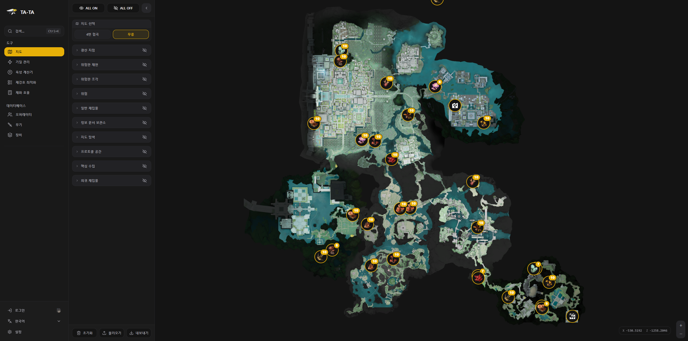
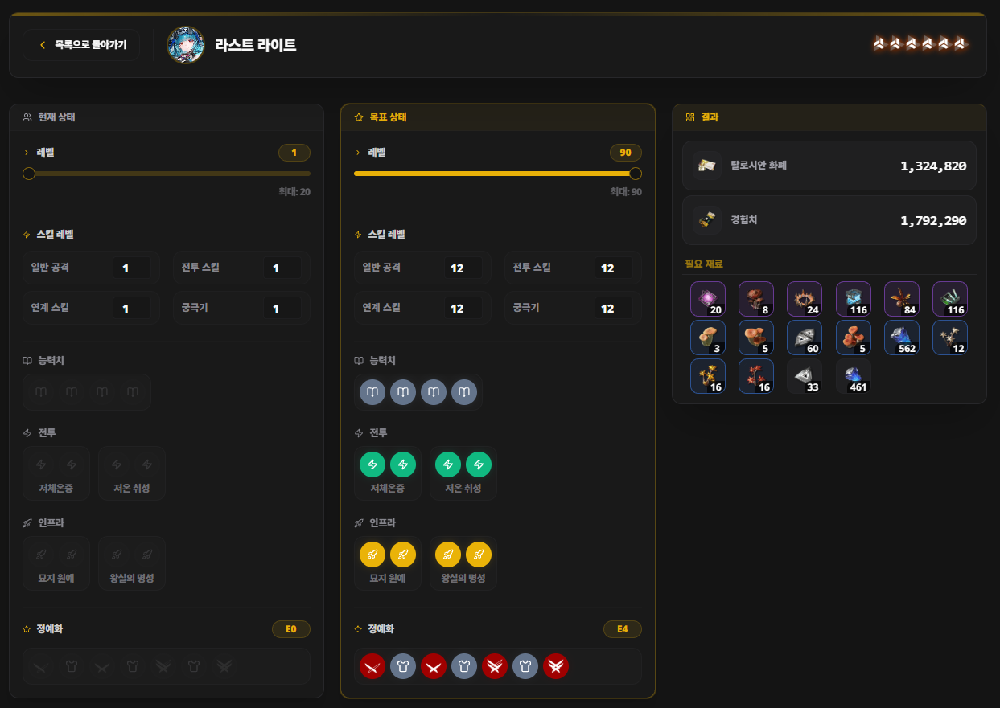
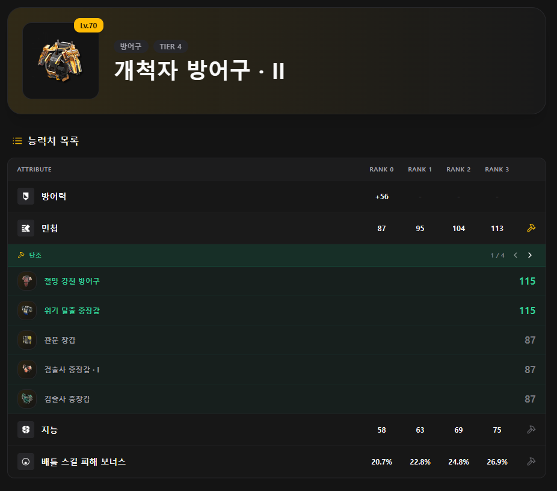

## 인터랙티브 맵 확장


초기에 만들었던 인터랙티브 맵은 45군데의 희귀 재료 스팟만 확인하고 체크하기 위한 단순한 형태였다.


하지만 이전부터 오픈월드 게임의 인터랙티브 맵 같은 도구를 직접 제대로 구현해보고 싶다는 생각이 있었기에, 본격적으로 지도 기능의 확장을 시작했다. 단순한 재료 채집용 지도가 아니라 필드의 보물상자 등 필드 탐사 요소 전반을 다룰 수 있는 종합 지도로 고도화하기로 했다.


지도를 구현하기 위해 선택한 라이브러리는 웹 지도 표준으로 널리 쓰이는 **Leaflet**과 React 래퍼인 **react-leaflet**이었다.


### 게임 3D 월드 좌표와 Leaflet 평면 좌표의 변환


일반적인 지도 서비스와 달리 게임 맵은 지구의 위도/경도가 아닌 게임 내부의 2D 평면 이미지와 좌표계를 다뤄야 한다. 이를 위해 Leaflet에서 제공하는 평면 직교 좌표계인 `L.CRS.Simple` 투영 방식을 사용했다.


여기서 가장 중요한 문제는 **인게임의 3D 월드 좌표를 2D 웹 지도 좌표로 변환하고 크기를 일치시키는 작업**이었다.

1. **좌표축의 매핑 (****`[Z, X]`** **변환)**:
    - 엔드필드 클라이언트 데이터에서 오브젝트의 위치는 3D 좌표 `(pos.x, pos.y, pos.z)`로 표현된다.
    - `x`는 가로축(동서), `y`는 고도(높이), `z`는 세로축(남북)이다. 2D 평면 지도에서는 고도인 `y`축을 무시한다.
    - 반면 Leaflet은 평면 직교 좌표계에서도 위치를 `[lat, lng]`, 즉 `[세로(Y), 가로(X)]` 순서의 배열로 받는다.
    - 따라서 인게임 좌표를 매핑할 때는 가로인 `x`를 `lng`에, 세로인 `z`를 `lat`에 배치하여 **`[pos.z, pos.x]`** **순서로 축을 뒤바꾸어 주어야 했다.**
2. **인게임 월드 경계(World Bounds)와 이미지 스케일 일치**:
    - 지도를 띄울 때 단순히 이미지 파일의 픽셀 크기(`[0, 0]` ~ `[height, width]`)를 기준으로 잡으면, 인게임 실제 좌표와 마커 위치의 비율이 어긋나게 된다.
    - 이를 해결하기 위해 각 구역 맵의 실제 인게임 3D 월드 경계 좌표(`worldBounds`)를 추출하여, 이를 Leaflet의 `bounds`이자 `ImageOverlay`의 영역으로 지정했다.

```typescript
// maps.ts: 각 구역 맵의 실제 인게임 월드 경계 좌표 정의
export const MAPS: MapConfig[] = [
  {
    id: "map01",
    name: "Map 01",
    image: "/images/temp/map01.webp",
    // [남서쪽(Z_min, X_min), 북동쪽(Z_max, X_max)] 인게임 실제 좌표
    worldBounds: [
      [-1023.60, -1022.64],
      [895.58, 1024.49]
    ],
  },
];
```


```typescript
// InteractiveMap.tsx: 좌표 변환 및 지도 렌더링
const currentMap = MAPS.find(m => m.id === selectedMapId) || MAPS[0];
const bounds = currentMap.worldBounds;

// 인게임 3D 좌표를 Leaflet 평면 좌표 [pos.z, pos.x] 로 변환
const processedMarkers = markers
  .filter(m => m.mapId === selectedMapId)
  .map(m => {
    const position = m.pos
      ? [m.pos.z, m.pos.x] as [number, number]
      : m.position;
    return { ...m, position };
  });

return (
  <MapContainer
    crs={L.CRS.Simple}
    bounds={bounds}
    maxBounds={bounds}
    zoomSnap={0}
    className="w-full h-full"
  >
    {/* 지도 배경 이미지를 인게임 월드 좌표계 경계에 1:1로 투영 */}
    <ImageOverlay url={currentMap.image} bounds={bounds} />

    {/* 변환된 좌표에 마커 렌더링 */}
    {processedMarkers.map((marker) => (
      <Marker
        key={marker.id}
        position={marker.position}
        icon={createCustomIcon(marker.type, foundMarkers.includes(marker.id), marker.amount || 1)}
      >
        <Popup className="custom-popup" closeButton={false}>
          {/* 마커 상세 정보 팝업 */}
        </Popup>
      </Marker>
    ))}
  </MapContainer>
);
```


이렇게 `ImageOverlay`의 바운드를 인게임 실제 월드 좌표와 일치시켜 두면, Leaflet 내부 엔진이 이미지와 좌표계를 1:1로 정렬해 준다. 덕분에 마커 데이터(`m.pos`)를 복잡한 픽셀 계산 수식으로 다시 변환할 필요 없이 `[pos.z, pos.x]` 형태로 넘겨주기만 해도 지도 이미지 상의 정확한 위치에 핀이 찍히게 되었다.


마우스 커서의 현재 위치를 표시할 때도 Leaflet 이벤트에서 받아온 `coords.lng`을 인게임 X 좌표로, `coords.lat`을 인게임 Z 좌표로 그대로 대응시켜 화면 우측 하단에 실시간 좌표를 출력할 수 있었다.





이렇게 해서 단순 체크용 맵에서 벗어나, 필드를 탐사할 때 켜두고 쓸 수 있는 완성도 높은 인터랙티브 맵이 갖추어졌다.


## 육성 계산기


엔드필드는 캐릭터와 무기를 육성하는 데 들어가는 재화의 종류와 수량이 매우 방대하다.


기본 레벨업 경험치와 탈로시안 화폐 외에도 단계별 돌파 재료, 일반/배틀/연계/궁극기 스킬 레벨업에 필요한 재료와 특수 재화, 재능 노드 개방 등 수많은 재료가 요구된다.


하지만 인게임 UI에서는 오직 다음 단계로 넘어가기 위한 요구치만 보여주기 때문에, 현재 상태에서 최종 육성 단계까지 총 얼마만큼의 재화가 필요한지 미리 파악하고 계획적으로 파밍하기가 어려웠다.


이 문제를 해결하기 위해 현재 상태와 목표 상태를 지정하면 필요한 누적 비용을 실시간으로 역산해주는 **육성 계산기(Ascension Planner)**를 추가했다.





인게임 레벨업 곡선과 데이터 테이블에서 추출한 수치들을 기반으로 계산 로직(`ascension-calc.ts`)을 작성했다:

- **오퍼레이터 육성**: 시작 레벨/돌파 단계부터 목표 레벨/돌파 단계까지 요구되는 총 경험치, 탈로시안 화폐, 등급별 돌파석 합산
- **스킬 및 재능 노드**: 4가지 전투 스킬 각각의 레벨(Rank 1 ~ Master 3)과 재능 노드, 패시브 노드 소모 재화 정밀 반영
- **무기 육성**: 무기 단계(T0 ~ T4)와 레벨업에 따른 전용 재화 별도 계산

캐릭터를 선택하고 현재 수치와 목표 수치를 맞추면 필요한 전체 재료 목록이 아이콘과 수량으로 정리되어 출력되므로, 요일 던전이나 파밍 계획을 직관적으로 세울 수 있게 되었다.


## 데이터베이스 구축


돌파 플래너를 구현하면서 게임 내 수치 데이터를 체계화하다 보니, 이 데이터를 바탕으로 유저들이 열람할 수 있는 DB 페이지를 구축하는 단계로 자연스럽게 이어졌다. 그렇게 오퍼레이터, 무기, 장비(Gear) 도감 페이지를 차례로 추가했다.


이 중에서도 가장 많은 고민을 거쳐 구현한 기능이 바로 **장비 DB의 단조(Artificing) 재료 장비 조회** 기능이었다.


엔드필드의 엔드스펙 세팅에서 핵심이 되는 시스템이 장비 단조다. T4 장비의 보조 속성 수치를 최대치로 끌어올리기 위해서는 단조가 필수적이다. 단조 규칙은 다음과 같다:

- 특정 보조 속성을 단조하려면, **동일한 장비 부위**이면서 **해당 보조 속성 수치가 기준치 이상인 장비**를 재료로 소모해야 한다.

문제는 인게임 도감이나 인벤토리에서는 특정 속성을 올리고 싶을 때 어떤 장비를 파밍해서 재료로 써야 하는지 한눈에 파악할 수 있는 경로가 없었다는 점이다. 유저들은 인게임 도감을 하나씩 뒤져가며 각 장비의 부옵션 종류와 기본 수치를 수작업으로 대조해야 했다.


이 번거로움을 해결하기 위해 장비 상세 페이지에서 원하는 보조 속성을 클릭하면, 해당 속성을 단조할 수 있는 재료 장비들을 즉시 필터링하여 보여주는 역방향 조회 로직을 작성했다.


```typescript
// GearAttributes.tsx 중 일부
// T4 장비의 특정 부옵션을 단조할 수 있는 재료 장비 목록 필터링
if (isT4 && key !== "attrType_3") {
  forgingMaterials = allGears.filter(g => {
    // 1. 같은 부위(part)인지 체크
    if (g.part !== gearData.part || !g.subAttrs) return false;

    // 2. 동일한 속성 타입을 가지고 있는지 매칭
    const mKey = getMatchingKey(g);
    if (!g.subAttrs[mKey]) return false;

    // 3. 재료 장비의 속성 수치가 현재 기본 수치 이상인지 확인
    const matValue = g.subAttrs[mKey].values[0];
    const isMatPercentage = matValue > 0 && matValue < 1;
    return isBasePercentage === isMatPercentage && matValue >= baseValue;
  });

  // 수치가 높은 순서대로 내림차순 정렬
  forgingMaterials.sort((a, b) => {
    const valA = a.subAttrs[getMatchingKey(a)].values[0];
    const valB = b.subAttrs[getMatchingKey(b)].values[0];
    if (valB !== valA) return valB - valA;
    return b.itemId.localeCompare(a.itemId);
  });
}
```





장비 상세 페이지에서 속성 항목 옆의 망치 아이콘을 누르면 하위 영역이 펼쳐지며, 해당 속성을 단조할 때 재료로 사용할 수 있는 장비 목록이 수치 순으로 정렬되어 페이지네이션과 함께 노출된다.


인게임 스탯을 일일이 확인할 필요 없이 클릭 한 번으로 파밍 목표 장비를 확인할 수 있게 되어 단조 시간을 크게 줄일 수 있었다.


## 기능 추가


처음에는 단순한 숙제 체크리스트로 시작했던 사이트였지만 인터랙티브 맵, 육성 계산기, 데이터베이스 등이 더해지면서 사이트의 형태가 어엿한 엔드필드 종합 정보 팬사이트가 되었다.


그런데도 뭔가 더 추가할만한 기능이 없을까 고민하다가 제강호가 눈에 들어오는데…

