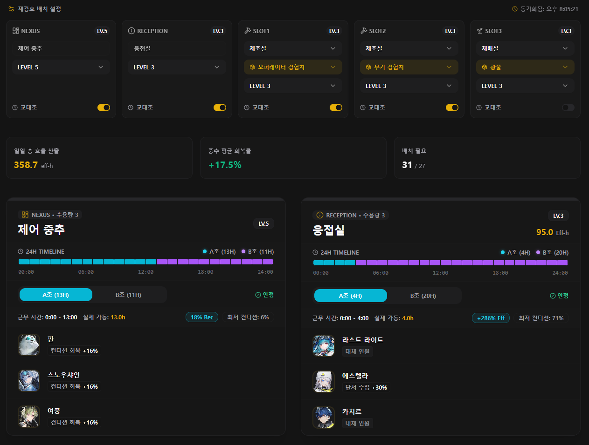

## 제강호 최적화 시뮬레이터


인터랙티브 맵과 돌파 플래너, 장비 도감까지 구축하면서 팬사이트로서의 기능은 제법 갖추어졌다. 그러던 중, **제강호**가 눈에 들어오고야 말았다.


제강호는 핵심 제어 중추, 제조실, 재배실, 응접실 등 다양한 선실에 오퍼레이터를 배치하여 자원을 생산할 수 있다. 언뜻 보기에는 선실별로 생산 효율 보너스가 가장 높은 오퍼레이터를 집어넣기만 하면 끝나는 단순한 문제처럼 보이지만, 게임 메커니즘을 뜯어볼수록 단순 연산으로는 도저히 최적해를 구할 수 없는 구조였다.


커뮤니티에서는 업데이트 때마다 최고 효율의 오퍼레이터 조합을 공유하는 글이 올라온다. 하지만 특정 오퍼레이터들을 뽑지 않은 유저들도 있고, 엔드필드를 늦게 시작한 유저들이라면 더욱 오퍼레이터가 부족할 것이다.


이를 해결하기 위해 현재 내가 보유 중인 오퍼레이터, 오퍼레이터 스킬의 해금 여부에 따라 최적해를 구하는 **제강호 최적화 시뮬레이터**를 추가하기로 했다.


### 오퍼레이터 효율

- **컨디션 기본 소모율**: 시간당 7.2%
- **컨디션 기본 회복률**: 시간당 12%
- **핵심 제어 중추 전역 회복 버프**: 핵심 제어 중추에 배치된 오퍼레이터들의 제강호 스킬(`mood_regen`) 합계에 비례하여 전체 선실 오퍼레이터들의 컨디션 회복 속도가 증가한다.
- **기초 효율 보너스**: 선실에 배치된 오퍼레이터는 고유 스킬과 무관하게 1명당 무조건 기초 효율 +40% 보너스를 제공한다.

### 단일 배치 환경과 가동률 모델


1.6 업데이트 이전에는 교대조 시스템이 없었다. 한 번 선실에 오퍼레이터를 배치해두면 일하다가 컨디션이 0%로 떨어지는데, **컨디션이 0%가 되어도 선실에서 쫓겨나는 것이 아니라 배치된 상태 그대로 생산에 영향을 주지 않으며 휴식을 취한다.** 휴식을 취하다가 컨디션이 다시 100%까지 회복되면 생산에 참여하는 구조였다.


따라서 상시 배치 상태에서 하루 동안의 실질 가동률을 계산하기 위해 가동률 모델과 승수 모델을 수립했다.


```plain text
Uptime = 전역 회복률 / (선실 소모율 + 전역 회복률)
Final Efficiency = (1 + 0.4 * 배치 인원 수) * (1 + 스킬 노드 합산) * Uptime
```

- **전역 회복률**: 중앙제어실 오퍼레이터들의 버프가 반영된 회복 속도
- **선실 소모율**: 해당 선실의 컨디션 감소 속도

### 그리디 알고리즘


컨디션 관련 오퍼레이터를 핵심 제어 중추에 넣어야 할지, 아니면 제조실에 직접 투입하여 생산 속도를 올릴 것인지는 제강호 전체 관점에서 고려해야 했다.


초기 버전에서는 기지 전체 유효 산출량 함수(`getGlobalEffectiveOutput`)를 정의하고, 모든 빈 선실 슬롯을 대상으로 남은 오퍼레이터 중 전체 산출량 증가폭이 가장 큰 오퍼레이터를 매 스텝마다 하나씩 확정해 나가는 통합 그리디 알고리즘으로 배치를 결정했다.


## 수동 휴식 관리 UI


교대조가 없을 때는 휴식 중인 오퍼레이터를 수동으로 다른 오퍼레이터로 교체해 효율을 올리기도 했었다.


이를 지원하기 위해 오퍼레이터 명단에서 캐릭터를 클릭하면 그레이스케일 처리와 함께 빨간 X 표시를 띄우며 최적화 풀(`restingOperatorIds`)에서 수동으로 제외하는 기능을 추가했다.


최적화 로직을 통해 선택된 캐릭터를 제외하고 현재 투입 가능한 대체 오퍼레이터들로 차순위 최적 배치를 즉시 다시 계산해 주었다.


## 교대조 시스템


그렇게 안정적으로 사용하던 중, 게임에 **1.6 업데이트**가 적용되었고, 각 선실마다 **A조와 B조를 편성하여 교대 근무를 돌리는 교대조 시스템**이 정식으로 추가되었다.


이 업데이트로 인해 최적화 모델을 완전히 다시 설계해야 했다.

1. 기존에는 컨디션이 회복되는 즉시 다시 일하기 시작했지만, 교대조 시스템에서는 조기에 컨디션을 100% 채우더라도 정해진 교대 시각이 되기 전까지는 일하지 않는다.
2. 컨디션이 0%가 되면 휴식하다가, 정해진 교대 시각에 다음 조와 교대한다.
3. A조가 일할 때 B조가 쉬고, B조가 일할 때 A조가 쉬므로 유저가 수동으로 휴식 중인 캐릭터를 제외할 필요가 없어졌다.

기존의 단순 가동률(Uptime) 수식과 수동 휴식 관리 UI(`DijiangOperatorList`)는 교대조 시스템에 맞지 않았다. 이제 선실별 오퍼레이터 조합에 따라 A조와 B조가 각각 몇 시간 씩 일해야 24시간 동안 최대 생산량을 유지할 수 있는 지를 교대 사이클 관점에서 계산해야 했다.


## O(1) 해석 솔버


A조와 B조의 교대 스케줄을 평가하기 위해 처음 생각할 수 있는 방법은 24시간을 1분 단위(1,440스텝)로 쪼개어 시뮬레이션하는 것이었다.


하지만 최적 배치를 찾으려면 수천 가지 이상의 오퍼레이터 조합을 평가해야 한다. 매 평가마다 1,440번의 틱 루프를 브라우저 메인 스레드에서 돌리면 웹 브라우저가 그대로 멈추어 버린다.


이 성능 병목을 어떻게 해결할지 고민하던 중, 아카라이브 엔드필드 채널에서 [제강호 최적화 분석 글](https://arca.live/b/akendfield/185341609)을 보게 되었다. 컨디션 소모와 회복의 정상 상태를 O(1)으로 해석하고, 시뮬레이티드 어닐링(Simulated Annealing)을 활용해 전역 최적 배치를 도출하는 수학적 접근법을 다룬 글이었는데, 내가 직면했던 성능 한계를 해결할 방법이었다.


해당 분석 글에서 다룬 이론적 모델과 아이디어를 바탕으로, 웹 브라우저 환경에서 즉시 쓸 수 있게 구현해 보기로 했다.


컨디션이 0%~100% 범위 내에서 일정한 비율로 소모되고 회복되는 패턴을 이용해, 복잡한 24시간 시뮬레이션을 돌리지 않고도 하루 동안의 실제 근무 시간과 회복량을 단 한 번의 연산으로 계산해내는 **O(1) Steady-State 해석 함수**를 작성했다.


```typescript
// optimizer.ts 중 주기적 정상 상태 해석 로직
function solveTeamOutput(
  start: number,
  duration: number,
  dropRate: number,
  R_schedule: PiecewiseRate[]
) {
  if (duration <= 0) return { worked: 0, minMood: 0, sustainable: true, exhausted: false };
  const restStart = (start + duration) % 24;
  const restDuration = 24 - duration;

  // 1. 비번/휴식 구간 동안의 누적 회복량(적분값) 계산
  let rem = restDuration;
  let t = restStart;
  let deltaR = 0;
  while (rem > 1e-6) {
    const p = R_schedule.find(x => t >= x.start && t < x.end) || R_schedule[0];
    const step = Math.min(rem, p.end - t);
    deltaR += p.rate * step;
    rem -= step;
    t = (t + step) % 24;
  }

  const safeDrop = Math.max(1e-4, dropRate);
  const maxPossibleWork = Math.min(duration, 100 / safeDrop);
  const moodEndIf100 = 100 - safeDrop * maxPossibleWork;

  // 2. 컨디션 100% 회복 지속 가능성 판별
  if (moodEndIf100 + deltaR >= 100) {
    return {
      worked: maxPossibleWork,
      minMood: moodEndIf100,
      sustainable: true,
      exhausted: maxPossibleWork < duration - 1e-4
    };
  } else {
    // 회복량이 부족할 경우 정상 상태 가동 시간 도출
    const worked = Math.min(duration, deltaR / safeDrop);
    return {
      worked,
      minMood: 0,
      sustainable: false,
      exhausted: true
    };
  }
}
```


이 O(1) 솔버를 바탕으로, 선실별 A조 근무 시간을 1시간부터 23시간까지(B조 = 24 - A조) 계산하여 **유저가 수동으로 슬라이더를 맞출 필요 없이 수학적으로 최대 산출량을 달성하는 최적 근무 시간을 자동으로 산출**할 수 있게 되었다.


## Simulated Annealing 전역 탐색


교대조가 도입되면서 선실당 슬롯 수는 2배(A조+B조)로 늘어났고, 교대 여부도 선실별로 설정이 가능하기 때문에 탐색 공간의 크기가 폭발적으로 증가했다.


기존의 그리디 알고리즘으로는 A조와 B조의 상호 배타성 제약과 전역 회복 버프 사이에서 지역 최적해를 벗어날 수 없었다. 이를 해결하기 위해 확률적 전역 최적화 알고리즘인 Simulated Annealing을 도입했다.


```typescript
// optimizer.ts 중 시뮬레이티드 어닐링 루프
let currentAssignments = JSON.parse(JSON.stringify(assignments));
let currentEval = evaluateShip(currentAssignments, rooms);
let bestAssignments = JSON.parse(JSON.stringify(currentAssignments));
let bestScore = currentEval.totalOutput;

let temp = 4.0; // 탐색 무작위성 허용치
const iterations = 3500;
const cooling = Math.pow(0.005 / temp, 1 / iterations);

for (let iter = 0; iter < iterations; iter++) {
  const moveType = Math.random() < 0.5 ? 0 : 1;

  if (moveType === 0 && activeSlots.length >= 2) {
    // 1. 서로 다른 활성 선실 슬롯 간의 오퍼레이터 교체
    // ... 슬롯 간 오퍼레이터 맞교환 ...
  } else if (activeSlots.length > 0) {
    // 2. 대기 오퍼레이터와 배치 오퍼레이터 교체
    // ... 대기 인원 투입 ...
  }

  const nextEval = evaluateShip(currentAssignments, rooms);
  const delta = nextEval.totalOutput - currentEval.totalOutput;

  // 개선된 배치는 무조건 채택, 일시적으로 효율이 떨어지는 배치도 확률적으로 허용
  if (delta > 0 || Math.exp(delta / temp) > Math.random()) {
    currentEval = nextEval;
    if (nextEval.totalOutput > bestScore) {
      bestScore = nextEval.totalOutput;
      bestAssignments = JSON.parse(JSON.stringify(currentAssignments));
    }
  } else {
    // 원상 복구
  }

  temp *= cooling; // 탐색이 진행될수록 무작위 허용치를 서서히 줄여나감
}
```

- **이웃 상태 전이**: 활성 슬롯 간 맞교환 및 대기 인원 투입
- **확률적 수용**: 효율이 일시적으로 줄어드는 배치라도 초기에는 일정 확률로 허용하여 지역 최적해의 함정을 탈출하고, 탐색이 진행될수록 허용 확률을 줄여가며 최종 최적 배치로 자연스럽게 수렴하게 된다.

앞서 작성한 정상 상태 평가가 O(1)으로 실행되기 때문에, **3,500회의 어닐링 반복 연산이 브라우저 메인 스레드에서 단 40ms 이내에 완료**되었다. 웹 워커 없이도 UI 지연이 전혀 발생하지 않는 최적화 로직을 구축할 수 있었다.


## 결과





제강호 최적화 시뮬레이터는 초기 듀티 사이클과 통합 그리디 모델에서 시작해, 1.6 교대조 업데이트를 거치며 가장 많은 고민과 공을 들였던 기능이었다.


그런데 이 시점에 이르자 프로젝트 전체의 볼륨이 너무 비대해져 있었다.

- Next.js App Router 기반의 풀스택 아키텍처
- MongoDB 유저 데이터베이스
- NextAuth 및 Google Drive AppData 연동
- 수십 개에 달하는 API 라우트와 서버리스 함수
- 복잡한 상태 동기화 관리

개인 프로젝트로서 이 방대한 풀스택 인프라를 유지보수하고 서버를 운영하는 게 점점 피곤해지기 시작했고, 꼭 이렇게 무거운 서버와 DB를 사용해야 하는지 고민이 되기 시작했다…

