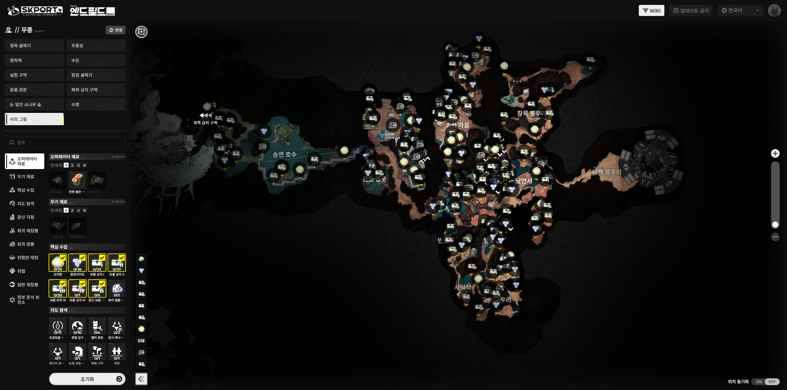
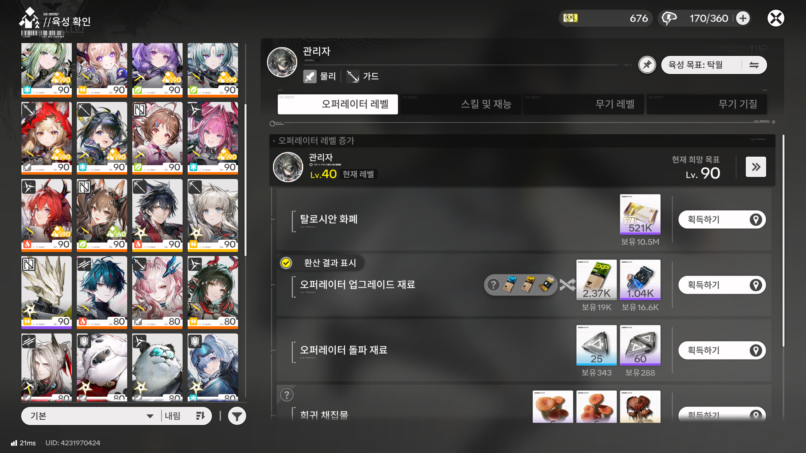
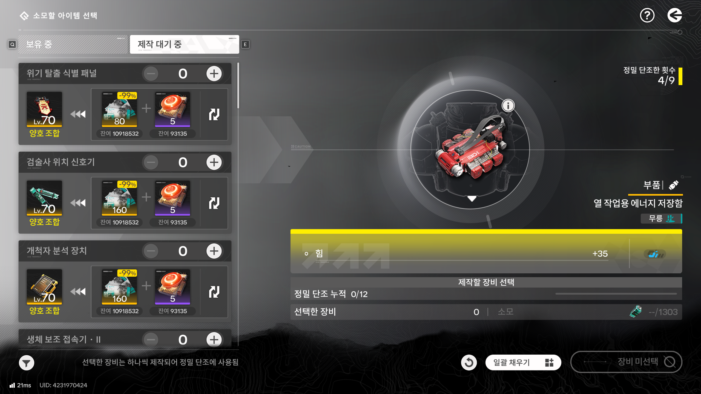
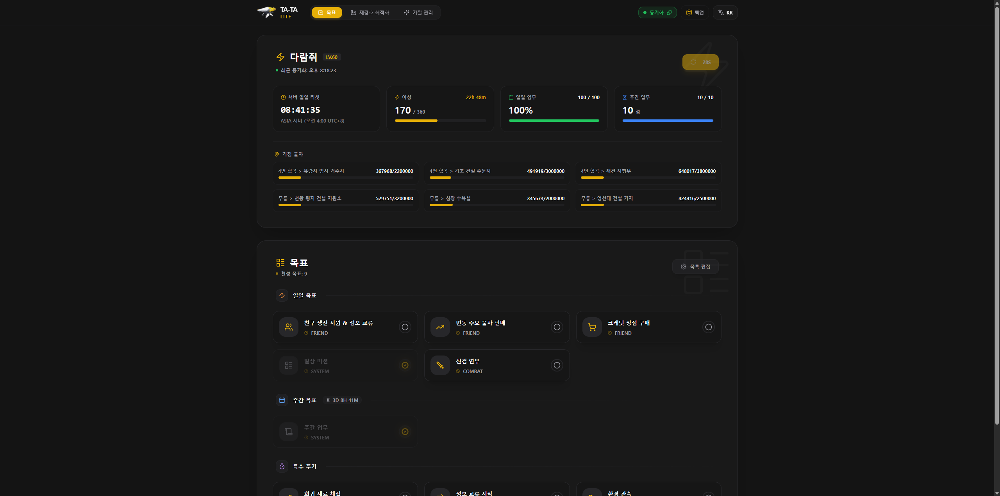

## 기능 추가와 제거의 기준

나는 보통 프로젝트를 진행할 때 **내가 직접 쓰면서 필요하다고 느끼는 기능**이나 **내가 구현해보고 싶었던 기능**들을 위주로 추가하는 편이다.

하지만 동시에 확고하게 가지고 있는 기준이 하나 있다.

다른 사람이 만든 대체 도구 중에 훨씬 뛰어난 것이 있거나, 공식 사이트 또는 인게임 클라이언트에서 해당 기능을 공식적으로 지원하기 시작한다면, 그 기능들은 내가 굳이 계속 붙들고 유지보수할 필요가 없다는 생각이다.

팬사이트의 역할은 게임이 채워주지 못하는 빈자리를 메워주는 것이지, 공식 기능을 어설프게 흉내 내며 리소스를 낭비하는 것이 아니기 때문이다.

시간이 지나면서 엔드필드 인게임과 공식 웹사이트에도 많은 편의성 업데이트가 이루어졌고, 자연스럽게 TA-TA가 품고 있던 수많은 기능들을 하나씩 돌아보게 되었다.

### 1. 인터랙티브 맵

공식 홈페이지에 공식 맵스가 업데이트되었을 때, TA-TA의 지도 기능을 바로 제거하려고 했었다. 하지만 초기 공식 맵스는 최적화가 덜 되어 있어 로딩 속도나 동작 안정성에 아쉬운 점이 많았기 때문에 TA-TA의 지도를 조금 더 유지하고 있었다.

그러다 얼마 전 공식 맵스가 대대적인 업데이트를 거치며 완전히 안정화되었고, 이제는 굳이 내가 지도를 유지할 이유가 완전히 사라졌다. 이에 따라 TA-TA에서도 인터랙티브 맵 페이지를 비활성화시켰다.

### 2. 육성 계산기와 단조 재료 추천

캐릭터와 무기 육성에 필요한 누적 재료를 계산해 주던 돌파 플래너 역시 인게임 업데이트를 통해 게임 내에서 자체적인 육성 계획 및 필요 재화 계산을 완벽하게 지원하기 시작했다.

단조 재료 조회 기능도 마찬가지였다. 게임 내에서 단조를 진행할 때 적합한 재료 장비를 자동으로 추천해 주는 편의 기능이 인게임에 도입되면서, 웹에서 복잡한 테이블을 열어 대조해 볼 필요성이 사라졌다.

### 3. 데이터베이스

오퍼레이터, 무기, 장비 스펙을 보여주던 DB 페이지는 사실 업데이트는 제일 귀찮으면서 이용률이 가장 낮은 기능이었다.

인게임에서도 대부분의 정보를 확인할 수 있을뿐더러, 엔드필드는 장비나 빌드를 연구할 때 인게임에서 장비를 직접 장착해보면 실시간으로 변경되는 스탯 수치를 즉시 확인할 수 있는 구조다. 굳이 웹사이트의 정적인 데이터베이스를 찾아와 확인할 필요가 없었다.

결국 사이트 볼륨의 절반 이상을 차지하던 대규모 기능들이 더 이상 유지할 이유가 없어진 것이다.

## 클라우드 서버 리소스의 한계

기능적인 다이어트 필요성과 함께, 인프라 측면에서도 현실적인 한계에 직면했다.

TA-TA는 Next.js App Router 기반의 풀스택 웹 애플리케이션으로 구동되고 있었다.

- Node.js 서버 런타임
- MongoDB 데이터베이스
- 세션 및 인증 처리
- 다국어 사전 로딩 및 SSR/SSG 혼합 파이프라인

개인 클라우드 서버에서 이 무거운 풀스택 인프라를 상시로 띄워두고 있었는데, 슬슬 다른 새로운 프로젝트를 시작하려고 보니 서버 자원이 턱없이 부족했다. TA-TA 하나가 서버의 메모리와 CPU 리소스를 너무 많이 점유하고 있어서, 동일한 서버에서 다른 프로젝트를 동시에 운영하면 둘 다 문제가 생기는 상황이었다.

더 이상 필요하지 않은 기능들을 위해 개인 서버 리소스를 이렇게까지 낭비할 이유는 없었다.

## 로그인 기능의 완전한 배제

또 한 가지 오랫동안 마음에 걸렸던 부분이 바로 **로그인 기능**이었다.

3편에서 다루었던 **TA-TA Sync 크롬 익스텐션**을 도입한 이후, 비로그인(게스트) 사용자들도 로컬스토리지 기반으로 사이트의 모든 기능을 제약 없이 사용할 수 있는 환경이 이미 갖추어져 있었다.

그럼에도 불구하고 기존에 가입해 두었던 구글 계정으로 계속해서 로그인을 유지하며 사용하는 유저들과 신규 로그인 사용자가 여전히 많았다. 로그인이 유지된다는 것은 구글 OAuth 토큰 갱신 실패로 인한 세션 만료 예외 처리, MongoDB와의 원격 동기화 레이스 컨디션 방어, NextAuth 세션 라이프사이클 관리 등 수많은 동기화 예외 처리와 잠재적 버그 위험을 끊임없이 안고 가야 한다는 것을 의미했다.

로그인 기능을 언젠가는 걷어내야겠다고 계속 생각은 하고 있었는데, 마침 대규모 기능 정리를 진행하는 김에 **로그인 시스템 자체를 사이트에서 아예 배제하기로 결정**했다.

## TA-TA lite

기존의 거대한 Next.js 풀스택 코드베이스를 유지보수하는 대신, 완전히 새로운 경량화 프로젝트인 **TA-TA lite**를 바닥부터 다시 구축했다.

1. **Vite + React 기반의 100% 정적 웹**
    - 무거운 Next.js 서버와 백엔드 API, MongoDB를 완전히 걷어냈다.
    - Vite와 React, TypeScript, Tailwind CSS를 기반으로 한 순수 정적 싱글 페이지 애플리케이션(SPA)으로 재구축했다.
2. **핵심 기능 3가지만 집중**
    - **태스크 트래커**: 일일/주간/쿨다운 숙제 체크 및 TA-TA Sync를 통한 실시간 이성/임무 동기화
    - **제강호 최적화**: 5편에서 구축했던 O(1) 정상 상태 해석 솔버와 시뮬레이티드 어닐링 전역 최적화 로직
    - **기질 관리**: 무기 기질 조합 최적화 및 파밍 가이드
3. **Local-First와 데이터 보호**
    - 로그인은 완전히 사라졌지만, 브라우저의 `LocalStorage`를 기반으로 모든 설정과 체크리스트가 안전하게 영구 보존된다.
    - 기기를 변경하거나 브라우저 캐시를 비울 때를 대비해, 원클릭으로 내 모든 데이터를 JSON 파일로 내보내고 불러올 수 있는 백업/복원 기능을 추가했다.

결과적으로 사이트 로딩 속도는 눈에 띄게 빨라졌고, 백엔드 서버 장애나 DB 연결 오류 같은 불안 요소도 완전히 사라졌다.

## 9개월의 여정

9개월 전, 단순히 내가 플레이하면서 숙제를 까먹지 않으려고 가벼운 마음으로 시작했던 체크리스트 사이트였다.

처음엔 디스코드 로그인과 MongoDB로 시작했다가, 보안을 위한 구글 로그인과 AppData 사용도 해봤고, 게스트 유저 지원을 위한 업데이트 중 새로고침 버그와 무한 루프의 늪에 빠지기도 했다.

CORS와 토큰 노출 문제를 뿌리 뽑기 위해 TA-TA Sync라는 전용 프록시를 직접 만들었고, 오픈월드 지도를 제대로 만들어보고 싶어 Leaflet 좌표계를 뜯어가며 인터랙티브 맵을 구축하기도 했다. 그리고 제강호의 복잡한 컨디션 메커니즘을 풀기 위해 수치해석 모델링과 시뮬레이티드 어닐링 알고리즘까지 구현해냈다.

되돌아보면 개인 프로젝트 하나에 정말 많은 시간과 공을 들였고, 수많은 기술적 삽질과 고민들이 녹아있던 시간이었다.

비록 사이트의 외형은 거대한 풀스택 사이트에서 다시 가벼운 정적 사이트인 `TA-TA lite`로 되돌아왔지만, 그 과정에서 겪었던 수많은 고민과 핵심 알고리즘들은 여전히 안정적으로 돌아가고 있다.

필요할 때 켜서 가장 빠르고 가볍게 숙제를 확인하는 도구, 결국 내가 처음 이 프로젝트를 시작했을 때 바랐던 본질로 되돌아온 셈이다.

